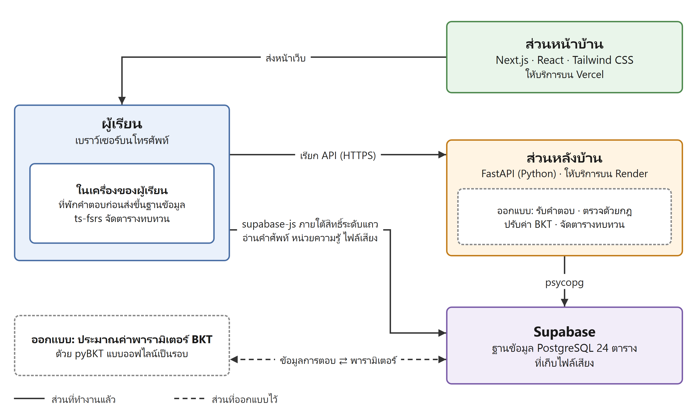
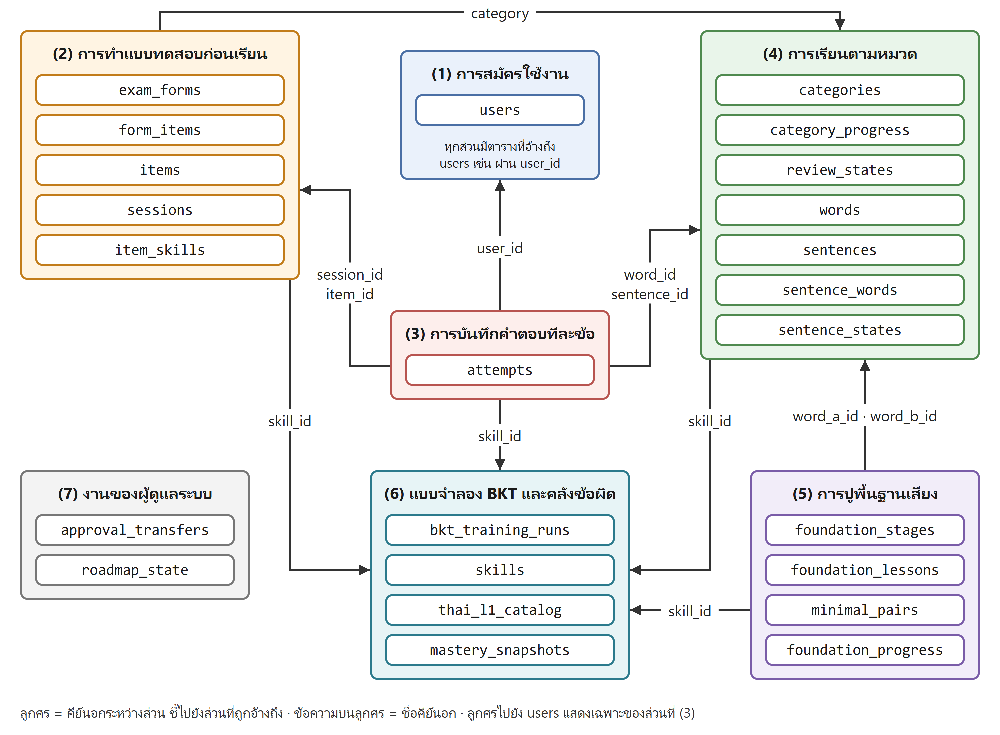
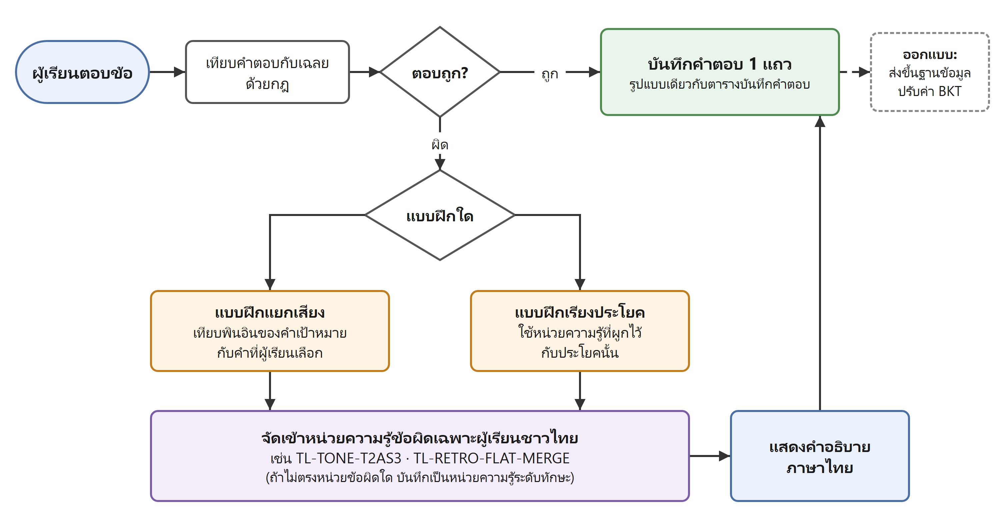
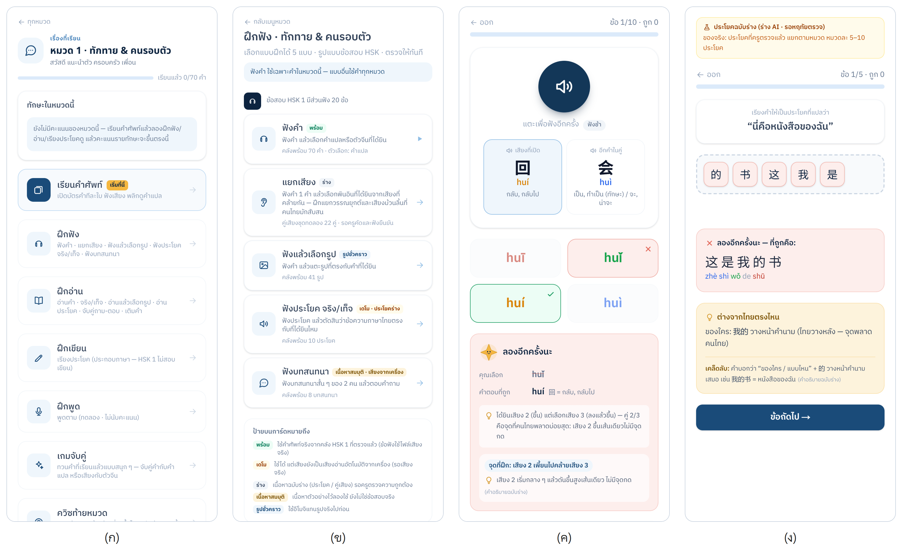

# ร่าง Full paper CSTI-MJU ครั้งที่ 8 — ฉบับที่ 1 (ข้อความพร้อมคัดลอกลงเทมเพลต)

> แผนและเหตุผลของแต่ละหัวข้ออยู่ที่ [[วิเคราะห์-FullPaper-CSTI-MJU8]] · ตัวเลขผลทดสอบรันใหม่บนเว็บจริงวันที่ 12 ต.ค. 2569
> **แก้แล้วตามผลตรวจ 4 ด้าน (ข้อเท็จจริง · การอ้างอิง · กฎของทีม · ภาษาไทยวิชาการ) รวม 172 จุด — 12 ต.ค. 2569** · ตัวเลขทุกตัวเทียบกับโค้ด/ไฟล์ต้นทางแล้ว
> **สมมุติฐานของร่างนี้:** ใช้บทคัดย่อที่ส่งแล้วแบบคำต่อคำ (ทางเลือก ① ในไฟล์วิเคราะห์ §4) ตัวบทจึงเขียนส่วนที่ยังไม่เสร็จว่า "ออกแบบให้…" และบอกสถานะจริงที่ตารางที่ 3 กับหัวข้อข้อจำกัดเท่านั้น · ถ้าอาจารย์ให้ปรับบทคัดย่อ ใช้ฉบับปรับท้ายไฟล์

## วิธีวางลงเทมเพลต (อ่านก่อน ไม่ต้องคัดลอกส่วนนี้)

> ✅ **15 ต.ค. 2569: ไม่ต้องวางมือแล้ว** — สคริปต์ `scripts/build_fullpaper_docx.py` วางข้อความจากไฟล์นี้ลงเทมเพลตให้ทั้งฉบับ → **`mju376-407.docx`** (ดูภาพรวมใน `mju376-407.pdf`) · แก้ข้อความ**ในไฟล์ .md นี้**แล้วรันสคริปต์ใหม่ได้ทุกครั้ง (`python scripts/build_fullpaper_docx.py` ต้อง `pip install pythainlp` ก่อน) · **ถ้าเริ่มแก้ในไฟล์ Word โดยตรงเมื่อไร ให้ถือ .docx เป็นไฟล์หลักและหยุดรันสคริปต์** (ไม่งั้นทับของที่แก้) · ขั้นตอนข้างล่างคงไว้เผื่อต้องวางมือ

1. คัดลอก `mjuF2027.docx` เป็นไฟล์ใหม่ เช่น `mju376-407.docx` แล้ววางทีละส่วน **วางแบบข้อความอย่างเดียว** (Ctrl+Shift+V หรือ "Keep Text Only") แล้วใช้ Format Painter จากย่อหน้าเดิมของเทมเพลต — ห้ามกดสไตล์จากแถบ Styles เพราะเป็น Times New Roman
2. ฟอนต์ TH SarabunPSK ทั้งฉบับ · ชื่อเรื่อง 16 หนา · หัวข้อหลัก 14 หนา · เนื้อความ 14 ปกติ · บรรทัดหน่วยงาน 14 เอียง · บรรทัดผู้ประสานงาน 12 ปกติ
3. เลข 1 และ * หลังชื่อผู้แต่ง และหน้าหน่วยงาน ให้ทำเป็น **ตัวยก** (Ctrl+Shift+=)
4. **อักษรจีนและพินอิน** (เช่น 是 shì · 了 · zhōng) TH SarabunPSK ไม่มีตัวเหล่านี้ → เลือกข้อความจีน/พินอินแล้วตั้งฟอนต์ เช่น Noto Sans SC หรือ SimSun แล้วเช็กใน PDF ว่าไม่เป็นกล่องสี่เหลี่ยม
5. **ตาราง:** วางบรรทัดที่คั่นด้วย `|` แล้วเลือกทั้งก้อน → แทรก → ตาราง → แปลงข้อความเป็นตาราง → ตัวคั่น "อื่น ๆ" ใส่ `|` · ชื่อตารางอยู่**เหนือ**ตาราง · ชื่อรูปอยู่**ใต้**รูป จัดกึ่งกลาง · หมายเหตุใต้ตารางที่ 1 วางเป็นย่อหน้าธรรมดาใต้ตาราง
6. **สมการ BKT** ใช้ แทรก → สมการ (Equation) พิมพ์ตามที่ให้ไว้
7. **รูปที่ 1–4 ใส่แล้ว** อยู่ที่ `fullpaper-รูป/` · รูป 1–3 สร้างด้วย `python scripts/gen_paper_figures.py` (มี .drawio แก้ต่อได้) · รูป 4 แคปจากเว็บจริงด้วย `node scripts/shoot_paper_fig4.cjs` · ข้อความใน 【 】 (ถ้ามี) คือที่ว่างรอข้อมูล
8. ลบข้อความคำสั่งสีน้ำเงิน/แดงในเทมเพลตให้หมด · แก้ File → Info → Title/Author · ห้ามเปิด "หน้าแรกแตกต่าง"
9. บรรทัดว่างในไฟล์นี้ = ขึ้นย่อหน้าใหม่
10. **เอกสารอ้างอิง:** วางแบบข้อความอย่างเดียวแล้วตัวเอียงจะหาย → ทำตัวเอียงเองตาม APA 7 ได้แก่ ชื่อวารสารและเลขปีที่ (volume) · ชื่อหนังสือ/ชื่อเอกสารมาตรฐาน/ชื่อหลักสูตร · ชื่อหน้าเว็บ · ชื่อซอฟต์แวร์และชุดข้อมูล

---

## ===== เริ่มเนื้อหาบทความ =====

### [ชื่อเรื่อง — 16 pt หนา]

ระบบติวเตอร์ภาษาจีนอัจฉริยะสำหรับคนไทย

INTELLIGENT CHINESE TUTORING SYSTEM FOR THAI LEARNERS

### [ผู้แต่ง — 14 pt ปกติ · เลข 1 และ * เป็นตัวยก]

หฤทัย ยุวรัตน์1, วรเดช ปิ่นทอง1, พยุงศักดิ์ เกษมสำราญ1, ปวีณ เขื่อนแก้ว1 และ สมนึก สินธุปวน1,*

Haluethai Yuwarat1, Woradech Pinthong1, Payungsak Kasemsumran1, Paween Khoenkaew1 and Somnuek Sinthupuan1,*

1 สาขาวิชาวิทยาการคอมพิวเตอร์ คณะวิทยาศาสตร์ มหาวิทยาลัยแม่โจ้ เชียงใหม่ 50290 ประเทศไทย

* ผู้นิพนธ์ประสานงาน: ผศ.ดร. สมนึก สินธุปวน  อีเมล: somnuk@mju.ac.th

### [บทคัดย่อ — ฉบับที่ส่งแล้ว คำต่อคำ]

บทคัดย่อ

โครงงานนี้มีวัตถุประสงค์เพื่อพัฒนาเว็บแอปพลิเคชันติวภาษาจีนสำหรับคนไทยที่ยังไม่มีพื้นฐานและต้องการสอบวัดระดับความรู้ภาษาจีน (เอชเอสเค) ระดับ 1 และ 2 เนื่องจากผู้ที่เรียนด้วยตนเองมักไม่ทราบว่าควรเริ่มเรียนจากสิ่งใด ตนเองยังอ่อนเรื่องใด และควรกลับมาทบทวนสิ่งใดก่อน ระบบจึงออกแบบให้ตอบคำถามทั้งสามข้อนี้ตามลำดับ กล่าวคือ เริ่มจากจัดลำดับบทเรียนและแบบฝึกให้เหมาะกับความสามารถของผู้เรียนแต่ละคน จากนั้นตรวจสอบระหว่างการฝึกว่าผู้เรียนยังไม่แม่นทักษะใด เช่น การแยกเสียงวรรณยุกต์ที่ 2 กับที่ 3 เสียงม้วนลิ้น และการเรียงลำดับคำตามแบบภาษาไทย แล้วอธิบายสาเหตุของข้อที่ผิดเป็นภาษาไทยพร้อมให้แบบฝึกซ่อมเสริมเฉพาะจุด และเตือนให้กลับมาทบทวนคำศัพท์และทักษะเหล่านั้นก่อนที่ผู้เรียนจะลืมตามหลักการทบทวนแบบเว้นระยะ เพื่อให้ทำงานได้ตามแนวทางดังกล่าว ระบบพัฒนาในรูปแบบเว็บแอปพลิเคชันที่ติดตั้งลงโทรศัพท์มือถือและใช้งานได้เช่นเดียวกับแอปพลิเคชันทั่วไป ส่วนหน้าบ้านพัฒนาด้วยภาษาไทป์สคริปต์บนเฟรมเวิร์กเน็กซ์เจเอสร่วมกับรีแอกต์ และจัดรูปแบบหน้าจอด้วยเทลวินด์ซีเอสเอส ให้บริการบทเรียนพื้นฐานเสียงและวรรณยุกต์ คลังคำศัพท์พร้อมเสียงอ่านและความหมายภาษาไทย แบบฝึกทักษะการฟังและการอ่าน และข้อสอบจำลองแบบจับเวลา ส่วนหลังบ้านพัฒนาด้วยภาษาไพทอนบนเฟรมเวิร์กฟาสต์เอพีไอ ทำหน้าที่คำนวณความน่าจะเป็นว่าผู้เรียนเข้าใจแต่ละทักษะแล้วหรือยัง โดยปรับค่าใหม่ทุกครั้งที่ผู้เรียนตอบคำถาม และจัดตารางทบทวนด้วยอัลกอริทึมทบทวนแบบเว้นระยะ จัดเก็บข้อมูลด้วยระบบฐานข้อมูลโพสต์เกรสคิวแอลบนบริการซูปาเบส และให้บริการผ่านระบบคลาวด์ ในด้านการวัดผล ระบบใช้ข้อสอบที่มีเฉลยตายตัวและตรวจด้วยกฎที่กำหนดไว้ล่วงหน้าทุกข้อ ตามเกณฑ์การให้คะแนนของการสอบจริง สำหรับทักษะด้านเสียง ระบบวินิจฉัยด้วยแบบฝึกเทียบคู่เสียงที่ต่างกันเพียงจุดเดียว เช่น วรรณยุกต์เสียงที่ 2 กับเสียงที่ 3 และเสียงม้วนลิ้น โดยให้ผู้เรียนฟังเสียงต้นแบบแล้วเลือกคำตอบ จึงระบุได้ว่าผู้เรียนแยกเสียงคู่ใดไม่ออกโดยไม่ต้องใช้การรู้จำเสียงพูด ทั้งนี้การประเมินการออกเสียงจากเสียงพูดของผู้เรียนอยู่นอกขอบเขตของโครงงาน เนื่องจากการสอบวัดระดับความรู้ภาษาจีนระดับ 1 และ 2 ไม่มีการสอบพูด ผู้เรียนจึงทราบทั้งคะแนนและสาเหตุของข้อที่ตอบผิด และใช้เวลาทบทวนเฉพาะจุดที่ยังไม่ผ่าน แทนการทบทวนทุกเรื่องซ้ำกันทั้งหมด

คำสำคัญ : ระบบติวเตอร์อัจฉริยะ  ภาษาจีน  ผู้เรียนชาวไทย  การสอบวัดระดับความรู้ภาษาจีน (เอชเอสเค)

### [Abstract — ฉบับที่ส่งแล้ว คำต่อคำ]

Abstract

The objective of this project is to develop a Chinese tutoring web application for Thai beginners who want to take the Chinese Proficiency Test (HSK) Levels 1 and 2. Learners who study on their own often do not know where to begin, which points they are weak in, or what they should review first, so the system is designed to answer these three questions in turn. It first sequences lessons and exercises according to each learner's ability; it then identifies during practice the skills a learner has not yet mastered, such as distinguishing Tone 2 from Tone 3, retroflex initials, and word order transferred from Thai, and explains the cause of each mistake in Thai together with targeted remedial exercises; and it reminds learners to return to those words and skills before they forget them, following the principle of spaced repetition. To work in this way, the system is implemented as a Progressive Web Application that can be installed and used on mobile phones. The frontend is developed in TypeScript with the Next.js (React) framework and Tailwind CSS, providing pronunciation and tone lessons, a vocabulary bank with audio and Thai meanings, listening and reading exercises, and timed mock examinations. The backend is developed in Python with the FastAPI framework, which estimates the probability that a learner has mastered each skill and updates it after every answer, and schedules reviews using a spaced repetition algorithm. Data is stored in a PostgreSQL database on Supabase and delivered through cloud services. For assessment, every examination item has a fixed answer key and is graded by predefined rules following the official scoring criteria. For sound-related skills, the system diagnoses through minimal-pair exercises in which two recordings differ in only one feature, such as Tone 2 versus Tone 3 or retroflex initials; the learner listens to a reference recording and selects an answer, so the system can identify which contrasts the learner cannot distinguish without using speech recognition. Assessing the learner's own pronunciation from recorded speech is outside the scope of this project, as HSK Levels 1 and 2 do not include a speaking test. Learners therefore see both their scores and the reasons for their mistakes, and can spend review time only on the points they have not yet mastered, rather than repeating every topic equally.

Keywords: Intelligent Tutoring System, Chinese Language, Thai Learners, Chinese Proficiency Test (HSK)

### [บทนำ]

บทนำ

การสอบวัดระดับความรู้ภาษาจีน (Hanyu Shuiping Kaoshi: HSK) เป็นการสอบมาตรฐานที่ใช้วัดระดับความสามารถภาษาจีนของผู้เรียนชาวต่างชาติ ปัจจุบันการสอบกำลังปรับเข้าสู่ระบบใหม่ที่เรียกว่า HSK 3.0 ตามมาตรฐานระดับความสามารถภาษาจีนสำหรับการศึกษาภาษาจีนนานาชาติ รหัส GF 0025—2021 (Ministry of Education of the People's Republic of China & State Language Commission, 2021) โดยหลักสูตรการสอบฉบับปี ค.ศ. 2025 กำหนดคำศัพท์ระดับ 1 ไว้ 300 คำ และข้อสอบระดับ 1 ประกอบด้วยส่วนการฟังและส่วนการอ่าน (Center for Language Education and Cooperation, n.d., 2025)

ผู้เริ่มต้นที่เรียนด้วยตนเองมักเผชิญคำถามสามข้อ ได้แก่ ควรเริ่มเรียนจากสิ่งใด ตนเองยังอ่อนเรื่องใด และควรกลับมาทบทวนสิ่งใดก่อน หากระบบการเรียนบอกได้เพียงว่าตอบถูกหรือผิด ผู้เรียนจะยังไม่ทราบสาเหตุของข้อที่ผิด ทั้งที่ข้อผิดของผู้เรียนชาวไทยจำนวนหนึ่งมีสาเหตุร่วมกันจากภาษาแม่

งานวิจัยที่ผ่านมาพบข้อผิดดังกล่าวใน 3 ด้าน ประการแรก ด้านวรรณยุกต์ Y. Li (2016) พบว่าผู้ฟังชาวไทย 24 คนที่ไม่เคยเรียนภาษาจีนสับสนวรรณยุกต์ที่ 2 กับที่ 3 มากที่สุด และ Rungruang และ Mu (2017) พบว่าผู้เรียนชาวไทย 14 คนรับรู้วรรณยุกต์ที่ 2 และที่ 3 ได้ถูกต้องร้อยละ 85.68 และ 78.00 ตามลำดับ ซึ่งต่ำกว่าวรรณยุกต์ที่ 1 และที่ 4 ประการที่สอง ด้านพยัญชนะ ภาษาไทยไม่มีพยัญชนะม้วนลิ้น (retroflex) แบบภาษาจีน ผู้เรียนบางส่วนจึงออกเสียงพยัญชนะม้วนลิ้นเป็นเสียงที่ไม่ม้วนลิ้น เช่น ออกเสียง zh ch sh เป็น z c s และออกเสียง r เป็นเสียง ล (Cai & Lee, 2015) และตุลยนุสรญ์ สุภาษา และ ฉี เสวียหง (2560) พบว่าร้อยละ 70 ของนักศึกษาชาวไทยระดับต้นและระดับกลางที่เข้าร่วมการศึกษาออกเสียง ch และ sh ผิด ประการที่สาม ด้านไวยากรณ์ นักเรียนชั้นมัธยมศึกษาปีที่ 6 แผนกศิลป์-ภาษาจีน 169 คน ตอบแบบทดสอบไวยากรณ์เรื่องบทเสริม (คำเสริมกริยา) ผิดร้อยละ 48.07 (นพพล จันทร์กระจ่างแจ้ง, 2562) และมีรายงานเชิงคุณภาพว่าผู้เรียนชาวไทยวางส่วนขยายนามตามลำดับแบบภาษาไทย (C. Zhang, 2023) ส่วน S. Zhang และคณะ (2026) พบว่านักศึกษาระดับมหาวิทยาลัยวางคำวิเศษณ์ 就是 ผิดตำแหน่งตามคำไทย “ก็คือ”

แอปพลิเคชันเรียนภาษาจีนหลายรายการที่ผู้เรียนชาวไทยเข้าถึงได้รองรับภาษาไทย มีระบบทบทวนคำศัพท์ และบางรายการให้ผลป้อนกลับด้านการออกเสียงแล้ว แต่จากการสำรวจของผู้วิจัยเมื่อเดือนกรกฎาคม พ.ศ. 2569 กับแอปพลิเคชันและเว็บไซต์ 6 รายการ ยังไม่พบรายการที่วินิจฉัยข้อผิดซึ่งมีสาเหตุจากภาษาแม่ของผู้เรียนชาวไทยแล้วอธิบายสาเหตุเป็นภาษาไทย โครงงานนี้จึงพัฒนาระบบติวเตอร์ที่นำข้อผิดเฉพาะผู้เรียนชาวไทยมาจัดเป็นหน่วยความรู้ (Knowledge Component: KC) และออกแบบให้ผูกหน่วยความรู้เข้ากับข้อสอบทุกข้อ ประเมินความแม่นยำรายหน่วยความรู้ด้วยการติดตามความรู้แบบเบส์ (Bayesian Knowledge Tracing: BKT) และจัดตารางทบทวนตามหลักการทบทวนแบบเว้นระยะ (spaced repetition)

โครงงานนี้มีวัตถุประสงค์ 3 ข้อ ได้แก่ 1) เพื่อจัดลำดับบทเรียนและแบบฝึกให้เหมาะกับความสามารถของผู้เรียนแต่ละคน 2) เพื่อวินิจฉัยจุดที่ผู้เรียนยังไม่แม่นระหว่างการฝึก อธิบายสาเหตุเป็นภาษาไทย และให้แบบฝึกซ่อมเสริมเฉพาะจุด และ 3) เพื่อเตือนให้ผู้เรียนกลับมาทบทวนก่อนลืมตามหลักการทบทวนแบบเว้นระยะ

ขอบเขตของโครงงานมีดังนี้ กลุ่มเป้าหมายคือผู้เรียนชาวไทยที่ไม่มีพื้นฐานภาษาจีน เนื้อหาระยะแรกครอบคลุมคำศัพท์ HSK ระดับ 1 จำนวน 300 คำใน 5 หมวด ส่วน HSK ระดับ 2 จะใช้โครงสร้างเดียวกันในระยะถัดไป ข้อสอบและแบบฝึกที่ให้คะแนนทุกข้อมีเฉลยตายตัวและตรวจด้วยกฎ โดยไม่ใช้แบบจำลองภาษาขนาดใหญ่ (Large Language Model: LLM) ตัดสินคำตอบ และการประเมินการออกเสียงจากเสียงพูดอยู่นอกขอบเขต เป้าหมายระยะยาวของระบบคือพาผู้เริ่มต้นไปถึงระดับที่สอบ HSK ระดับ 1 ได้ตามแผนการเรียนราว 8 สัปดาห์ ส่วนบทความนี้รายงานการออกแบบ ผลการพัฒนา และผลการทดสอบการทำงานของระบบ โดยการทดลองใช้กับผู้เรียนอยู่ระหว่างการเตรียมการ

### [ทบทวนวรรณกรรม]

ทบทวนวรรณกรรม

บทความนี้ทบทวนแนวคิดและงานวิจัย 5 ด้านที่นำมาใช้ออกแบบระบบ ดังนี้

ข้อผิดของผู้เรียนชาวไทยที่เกิดจากภาษาแม่

ด้านวรรณยุกต์ นอกจากงานด้านการรับรู้เสียงของ Y. Li (2016) กับ Rungruang และ Mu (2017) แล้ว L. Zhang และ Liu (2020) วิเคราะห์ทางกลสัทศาสตร์ (acoustic analysis) ของวรรณยุกต์ที่ผู้เรียนชาวไทยออกเสียง และพบว่าวรรณยุกต์ที่ 2 มีช่วงเสียงขึ้นไม่เพียงพอ ส่วนวรรณยุกต์ที่ 3 ในพยางค์เดี่ยวและท้ายประโยคออกเสียงไม่ครบทั้งช่วงเสียงตกและช่วงเสียงขึ้น ในด้านการรับรู้ H. Zhang และคณะ (2025) ทดสอบการฟังระบุวรรณยุกต์ของผู้เรียนชาวไทย 22 คนซึ่งส่วนใหญ่อยู่ระดับกลางถึงสูง และพบว่าเมื่อผู้เรียนระบุวรรณยุกต์ที่ 3 ผิด ส่วนใหญ่ระบุเป็นวรรณยุกต์ที่ 2 ทั้งเมื่อฟังเสียงพูดระดับปกติและเสียงพูดดัง ขณะที่ Aroonawongsa และคณะ (2025) เปรียบเทียบระบบวรรณยุกต์ไทยกับจีน พร้อมเสนอลำดับการสอนวรรณยุกต์สำหรับผู้เรียนชาวไทย

ด้านพยัญชนะ Cai และ Lee (2015) วิเคราะห์เปรียบต่าง (contrastive analysis) ระบบเสียงไทยกับจีน และชี้ว่าภาษาไทยไม่มีพยัญชนะม้วนลิ้น ตุลยนุสรญ์ สุภาษา และ ฉี เสวียหง (2560) พบว่าพยัญชนะ zh ch sh r z c s และ x เป็นปัญหาของนักศึกษาชาวไทย และข้อผิดบางส่วนยังคงอยู่แม้ในนักศึกษาระดับสูง ส่วน Kitikanan และ Al-Tamimi (2012) ศึกษาผู้พูดภาษาไทย 3 คนที่ยังไม่เคยเรียนภาษาจีน และพบว่าเมื่อตัดสินด้วยการฟัง เสียงเสียดแทรก sh และ x ออกได้ตรงเป้าหมายเพียงร้อยละ 40 แต่ผลทางกลสัทศาสตร์พบว่าเสียง sh ไม่ต่างจากของเจ้าของภาษาอย่างมีนัยสำคัญ ส่วนเสียงที่ยากอย่างชัดเจนคือ x

ด้านไวยากรณ์ นอกจากข้อผิดเรื่องบทเสริม (นพพล จันทร์กระจ่างแจ้ง, 2562) แล้ว Pichaichanlert (2022) พบข้อผิดบทเสริมผลหลายประเภท เช่น เลือกใช้คำผิดและวางผิดตำแหน่ง งานด้านลักษณนามพบข้อผิดการใช้ลักษณนาม 个 และลักษณนามของสัตว์ (Kongkamnerd, 2024; L. Li & Imsamran, 2021) นอกจากนี้ Huang และ Funoi (2024) พบการละองค์ประกอบในประโยคสนทนา

ผู้วิจัยจึงนำหลักฐานเหล่านี้มาจัดเป็นคลังข้อผิดเฉพาะผู้เรียนชาวไทย 15 หน่วยความรู้ใน 3 กลุ่ม ดังตารางที่ 1 โดยระบุข้อจำกัดของหลักฐานกำกับไว้ในตาราง สำหรับหน่วยความรู้ที่หลักฐานยังเป็นเชิงคุณภาพ เป็นหลักฐานทางอ้อม หรือยังไม่พบงานที่วัดกับผู้เรียนชาวไทยโดยตรง

ตารางที่ 1 คลังข้อผิดเฉพาะผู้เรียนชาวไทย 15 หน่วยความรู้ และหลักฐานอ้างอิง

กลุ่ม | รหัสหน่วยความรู้ | ลักษณะข้อผิด | หลักฐาน
วรรณยุกต์ | TL-TONE-T2AS3 | รับรู้หรือออกเสียงวรรณยุกต์ที่ 2 เป็นวรรณยุกต์ที่ 3 | Y. Li (2016); Rungruang และ Mu (2017); L. Zhang และ Liu (2020)
วรรณยุกต์ | TL-TONE-T3AS2 | รับรู้หรือออกเสียงวรรณยุกต์ที่ 3 เป็นวรรณยุกต์ที่ 2 | H. Zhang และคณะ (2025) (หลักฐานด้านการรับรู้)
วรรณยุกต์ | TL-TONE-T3HALF | ออกเสียงวรรณยุกต์ที่ 3 ไม่ครบทั้งช่วงเสียงตกและช่วงเสียงขึ้นในพยางค์เดี่ยวหรือท้ายประโยค | L. Zhang และ Liu (2020)
วรรณยุกต์ | TL-TONE-T3SANDHI | ไม่เปลี่ยนวรรณยุกต์ที่ 3 ของพยางค์หน้าเป็นวรรณยุกต์ที่ 2 เมื่อตามด้วยวรรณยุกต์ที่ 3 (3+3 → 2+3) | Aroonawongsa และคณะ (2025) (เชิงคุณภาพ จากการสังเกตในชั้นเรียน ยังไม่พบงานที่วัดเป็นตัวเลขกับผู้เรียนชาวไทย)
วรรณยุกต์ | TL-TONE-T4OVER | ออกเสียงวรรณยุกต์ที่ 4 ลากยาวเกินไป | L. Zhang และ Liu (2020); Aroonawongsa และคณะ (2025)
พยัญชนะม้วนลิ้น | TL-RETRO-SH-S | ออกเสียง sh เป็น s | Cai และ Lee (2015); ตุลยนุสรญ์ สุภาษา และ ฉี เสวียหง (2560); Kitikanan และ Al-Tamimi (2012)
พยัญชนะม้วนลิ้น | TL-RETRO-ZH-JZ | ออกเสียง zh เป็น j หรือ z | Cai และ Lee (2015); ตุลยนุสรญ์ สุภาษา และ ฉี เสวียหง (2560)
พยัญชนะม้วนลิ้น | TL-RETRO-CH-CQ | ออกเสียง ch เป็น q หรือ c | Cai และ Lee (2015); ตุลยนุสรญ์ สุภาษา และ ฉี เสวียหง (2560)
พยัญชนะม้วนลิ้น | TL-RETRO-R-L | ออกเสียง r เป็น ล หรือ ร แบบไทย | Cai และ Lee (2015)
พยัญชนะม้วนลิ้น | TL-RETRO-FLAT-MERGE | แยกเสียงม้วนลิ้น zh ch sh กับเสียงไม่ม้วนลิ้น z c s ไม่ออก | Cai และ Lee (2015); ตุลยนุสรญ์ สุภาษา และ ฉี เสวียหง (2560); Kitikanan และ Al-Tamimi (2012) (หลักฐานด้านการออกเสียง ยังไม่พบงานที่วัดการฟังแยกเสียงกับผู้เรียนชาวไทยโดยตรง)
ไวยากรณ์ | TL-GRAM-DE-ORDER | วางส่วนขยายนามกับ 的 หลังคำนามแบบภาษาไทย | C. Zhang (2023) (เชิงคุณภาพ ยังไม่พบงานที่วัดเป็นตัวเลขกับผู้เรียนชาวไทย)
ไวยากรณ์ | TL-GRAM-MW | เรียงลำดับหรือเลือกลักษณนามผิด หรือละลักษณนาม | Kongkamnerd (2024); L. Li และ Imsamran (2021); Huang และ Funoi (2024) (พบข้อผิดการเลือกและการละลักษณนาม ส่วนการเรียงลำดับยังไม่พบงานที่วัดกับผู้เรียนชาวไทยโดยตรง)
ไวยากรณ์ | TL-GRAM-COMPL | เลือกใช้บทเสริมผิด วางบทเสริมผิดตำแหน่ง หรือละบทเสริม | นพพล จันทร์กระจ่างแจ้ง (2562); Pichaichanlert (2022)
ไวยากรณ์ | TL-GRAM-LE | ใช้คำช่วย 了 ผิดโดยเทียบตรงกับคำว่า “แล้ว” | Hao และคณะ (2022) (หลักฐานทางอ้อม: งานคลื่นไฟฟ้าสมองกับผู้เรียนชาวไทยระดับ HSK 5 ไม่ใช่การวิเคราะห์ข้อผิด ผู้วิจัยชี้ว่า “แล้ว” ตรงกับ 了 เพียงบางส่วน และผลของกลุ่มไทยไม่ต่างจากกลุ่มอินโดนีเซีย)
ไวยากรณ์ | TL-GRAM-ADV | วางคำวิเศษณ์ไว้หลังกริยาแบบภาษาไทย | S. Zhang และคณะ (2026) (หลักฐานทางอ้อม: พบการวางคำวิเศษณ์ 就是 ผิดตำแหน่งตามคำไทย “ก็คือ” ยังไม่พบงานที่วัดการวางคำวิเศษณ์ไว้หลังกริยากับผู้เรียนชาวไทยโดยตรง)

หมายเหตุ ตุลยนุสรญ์ สุภาษา และ ฉี เสวียหง (2560) ระบุว่าพยัญชนะใดออกเสียงผิด แต่ไม่ได้ระบุเสียงที่ใช้แทน ทิศทางการออกเสียง zh ch sh เป็น z c s มาจาก Cai และ Lee (2015) ส่วน Kitikanan และ Al-Tamimi (2012) พบปัญหาของเสียง sh เฉพาะเมื่อตัดสินด้วยการฟัง ทิศทาง zh เป็น j และ ch เป็น q ยังไม่พบงานที่วัดกับผู้เรียนชาวไทยโดยตรง

การติดตามความรู้แบบเบส์และตารางจับคู่ข้อสอบกับหน่วยความรู้

การติดตามความรู้แบบเบส์ (Corbett & Anderson, 1994) มองความรู้ในแต่ละหน่วยความรู้เป็นสถานะที่สังเกตไม่ได้โดยตรง 2 สถานะ คือรู้แล้วกับยังไม่รู้ และปรับความน่าจะเป็นว่าผู้เรียนรู้หน่วยนั้นแล้วทุกครั้งที่ผู้เรียนตอบ โดยใช้พารามิเตอร์ 4 ตัว ได้แก่ ความน่าจะเป็นที่รู้ตั้งแต่ต้น P(L0) ความน่าจะเป็นที่เรียนรู้ได้ในแต่ละโอกาส P(T) ความน่าจะเป็นที่รู้แต่ตอบผิด P(S) และความน่าจะเป็นที่ไม่รู้แต่เดาถูก P(G) ไลบรารี pyBKT (Badrinath et al., 2021) ช่วยประมาณพารามิเตอร์เหล่านี้จากข้อมูลการตอบ การใช้แบบจำลองนี้ต้องมีตารางที่ระบุว่าข้อสอบแต่ละข้อวัดหน่วยความรู้ใด (Q-matrix) หลักการนี้นำมาใช้ออกแบบให้ข้อสอบทุกข้อในระบบมีการระบุหน่วยความรู้ที่วัดกำกับไว้ ทั้งหน่วยความรู้ด้านทักษะและด้านข้อผิดเฉพาะผู้เรียนชาวไทย

การทบทวนแบบเว้นระยะและผลของการทดสอบต่อความจำ (testing effect)

Cepeda และคณะ (2006) วิเคราะห์อภิมาน (meta-analysis) จากงานทดลอง 317 รายการ และพบว่าการฝึกแบบเว้นระยะ (distributed practice) ช่วยให้จำได้ดีกว่าการฝึกต่อเนื่องในคราวเดียว (massed practice) ส่วน Roediger และ Karpicke (2006) พบว่าการทำแบบทดสอบช่วยให้จำได้ระยะยาวดีกว่าการอ่านซ้ำ ในด้านการจัดตารางทบทวน Settles และ Meeder (2016) เสนอแบบจำลองการทบทวนที่ฝึกจากข้อมูลผู้เรียนของแอปพลิเคชันเรียนภาษา และ Ye และคณะ (2022) เสนออัลกอริทึมจัดตารางทบทวนบนแบบจำลองความจำของผู้เรียน หลักการนี้นำมาใช้ออกแบบให้ระบบจัดตารางทบทวนคำศัพท์ด้วยอัลกอริทึม FSRS (Free Spaced Repetition Scheduler) ผ่านไลบรารี ts-fsrs (Open Spaced Repetition, 2026) และให้ผู้เรียนฝึกด้วยการตอบคำถามแทนการอ่านซ้ำ

การฝึกรับรู้วรรณยุกต์และข้อจำกัดของการรู้จำเสียงพูด

Wang และคณะ (1999) จัดการฝึก 8 ครั้งในเวลา 2 สัปดาห์ให้ผู้ฟังชาวอเมริกันแยกวรรณยุกต์ภาษาจีน และพบว่าความแม่นยำเพิ่มขึ้นราวร้อยละ 21 และผลการฝึกยังคงอยู่เมื่อทดสอบซ้ำหลัง 6 เดือน โดยการฝึกใช้เสียงจากผู้พูดหลายคน ส่วนด้านการใช้การรู้จำเสียงพูดอัตโนมัติ (Automatic Speech Recognition: ASR) Inceoglu และคณะ (2023) เปรียบเทียบผลการรู้จำเสียงพูดอัตโนมัติกับการถอดความของผู้ฟังเจ้าของภาษา 12 คน ต่อเสียงพูดภาษาอังกฤษของผู้เรียนชาวไต้หวัน 4 คน และพบว่าแม้คะแนนรวมใกล้เคียงกัน แต่ผลรายผู้พูดของระบบสอดคล้องกับการตัดสินของผู้ฟังเพียง 2 ใน 4 คนในแต่ละงานทดสอบ แสดงว่าความใกล้เคียงนี้ขึ้นกับตัวผู้พูดและชนิดของถ้อยคำ หลักการนี้นำมาใช้ออกแบบให้ระบบวินิจฉัยด้านเสียงทางการฟังด้วยคู่เสียงที่ต่างกันเพียงจุดเดียว และไม่ใช้ผลการรู้จำเสียงพูดเป็นคะแนน

มาตรฐานและรูปแบบข้อสอบ HSK ระบบ 3.0

มาตรฐาน GF 0025—2021 แบ่งระดับความสามารถภาษาจีนเป็น 3 ขั้น 9 ระดับ (Ministry of Education of the People's Republic of China & State Language Commission, 2021) และหลักสูตรการสอบ HSK ฉบับปี ค.ศ. 2025 กำหนดคำศัพท์ระดับ 1 จำนวน 300 คำ (Center for Language Education and Cooperation, 2025) ส่วนข้อสอบตัวอย่างทางการระดับ 1 มีส่วนการฟังและส่วนการอ่าน ส่วนละ 20 ข้อ ไม่มีส่วนการเขียนและการพูด โดยชุดข้อสอบตัวอย่างทางการมีข้อสอบพูดแยกเฉพาะระดับ 3 ถึง 6 (Center for Language Education and Cooperation, n.d.) ระบบจึงยึดหลักสูตรของ HSK 3.0 ซึ่งเริ่มใช้ในเดือนกรกฎาคม ค.ศ. 2026 และใช้รูปแบบข้อสอบที่มีเฉลยตายตัวของส่วนการฟังและการอ่านเป็นแกนของแบบฝึกและการวัดผล

### [วิธีการดำเนินการวิจัย]

วิธีการดำเนินการวิจัย

การวิจัยนี้เป็นการวิจัยและพัฒนา (Research and Development) แบ่งเป็น 4 ขั้นตอน ได้แก่ 1) การศึกษาและรวบรวมข้อมูล 2) การวิเคราะห์และออกแบบระบบ 3) การพัฒนาระบบ และ 4) การทดสอบและการวางแผนประเมินผล มีรายละเอียดดังนี้

1. การศึกษาและรวบรวมข้อมูล

1.1 ความต้องการของระบบ ได้จาก 3 แหล่ง ได้แก่ 1) งานวิจัยเกี่ยวกับข้อผิดของผู้เรียนชาวไทย 2) ข้อกำหนดจากการปรึกษาอาจารย์ที่ปรึกษา คือ เน้นการเตรียมสอบ HSK ระดับ 1–2 ตรวจคำตอบด้วยกฎโดยเทียบกับเฉลยตายตัว เน้นการสื่อสารและความเข้าใจในการฟังมากกว่าการปรับสำเนียง และให้ผู้เรียนทุกคนเรียนตามเส้นทางเนื้อหาหลักเดียวกัน และ 3) การสำรวจแอปพลิเคชันและเว็บไซต์เรียนภาษาจีน 6 รายการเมื่อเดือนกรกฎาคม พ.ศ. 2569

1.2 คลังคำศัพท์และเนื้อหา รายการคำศัพท์ HSK ระดับ 1 จำนวน 300 คำได้จากการเทียบรายการที่เผยแพร่บนเว็บไซต์อิสระ 2 แห่ง คือ HSK1.org (n.d.) และ Mandarin Bean (2026) ซึ่งตรงกันครบทั้ง 300 คำ และเท่ากับจำนวนคำระดับ 1 ในหลักสูตรการสอบ (Center for Language Education and Cooperation, 2025) ข้อมูลพินอิน อักษรตัวเต็ม และความหมายภาษาอังกฤษนำมาจากชุดข้อมูลเปิด complete-hsk-vocabulary (drkameleon, n.d.) ซึ่งมีต้นทางจากพจนานุกรม CC-CEDICT (MDBG, n.d.) และเติมพินอินส่วนที่ขาดด้วยไลบรารี pypinyin จากนั้นแก้พินอินของคำหลายเสียงที่ชุดข้อมูลเลือกเสียงไม่ตรงกับความหมายในระดับ 1 จำนวน 15 คำ และยังมีพินอินอีก 11 คำที่รอผู้ตรวจยืนยัน ความหมายภาษาไทยร่างด้วยปัญญาประดิษฐ์ แล้วผู้นิพนธ์ร่วมที่สอบผ่าน HSK ระดับ 5 ตรวจครบทั้ง 300 คำ

คำศัพท์จัดเป็น 5 หมวดตามสถานการณ์การใช้ ได้แก่ หมวด “ทักทายและคนรอบตัว” 70 คำ หมวด “ตัวเลข เวลา และวันที่” 51 คำ หมวด “กิน ดื่ม และซื้อของ” 63 คำ หมวด “เรียน ทำงาน และสื่อสาร” 50 คำ และหมวด “เดินทางและชีวิตประจำวัน” 66 คำ โดยใช้ปัญญาประดิษฐ์ร่างการจัดหมวดอย่างอิสระต่อกัน 3 ชุด ซึ่งทั้ง 3 ชุดจัดหมวดตรงกัน 292 คำจาก 300 คำ แล้วผู้นิพนธ์ร่วมคนเดียวกันตรวจอนุมัติการจัดหมวดทั้ง 300 คำ เสียงอ่านคำศัพท์สร้างด้วยเครื่องมือสังเคราะห์เสียงพูดจากข้อความ (text-to-speech) edge-tts เสียง zh-CN-XiaoxiaoNeural ที่ความเร็วลดลงร้อยละ 10 จำนวน 300 ไฟล์ ซึ่งยังไม่ได้ผ่านการฟังตรวจโดยผู้ตรวจ

1.3 คลังข้อผิดเฉพาะผู้เรียนชาวไทย ประกอบด้วย 15 หน่วยความรู้ใน 3 กลุ่ม คือ วรรณยุกต์ พยัญชนะม้วนลิ้น และไวยากรณ์ (ตารางที่ 1) แต่ละหน่วยความรู้มีข้อมูล ได้แก่ ลักษณะข้อผิด สาเหตุจากภาษาไทย ตัวอย่าง แนวทางสร้างตัวลวง (distractor) วิธีสอน และหลักฐานอ้างอิง หลักฐานทุกชิ้นผ่านการตรวจด้วยเกณฑ์ 3 ข้อ คือ ตีพิมพ์จริง เข้าถึงได้ และเนื้อหารองรับข้ออ้าง ผลการตรวจงานวิจัย 17 ชิ้นพบว่ายืนยันได้ครบ 14 ชิ้น และยืนยันได้บางส่วน 3 ชิ้น ในจำนวนนี้ Rungruang และ Mu (2017) มีเนื้อหาและตัวเลขตรงกับต้นฉบับ แต่ข้อมูลบรรณานุกรมที่บันทึกไว้เดิมระบุผู้แต่งและเลขหน้าคลาดเคลื่อน ซึ่งแก้ไขแล้ว Hao และคณะ (2022) รองรับข้ออ้างได้เพียงบางส่วน จึงใช้เป็นหลักฐานทางอ้อมและระบุข้อจำกัดไว้ในตารางที่ 1 ส่วนอีก 1 ชิ้นเข้าถึงฉบับเต็มไม่ได้ จึงไม่นำมาใช้ บทความนี้จึงใช้หลักฐาน 16 ชิ้น คลังฉบับปัจจุบันเป็นฉบับร่างที่รอผู้ตรวจด้านภาษาจีนอนุมัติ

2. การวิเคราะห์และออกแบบระบบ

2.1 สถาปัตยกรรมของระบบ ระบบแบ่งเป็น 3 ส่วนดังรูปที่ 1 ได้แก่ ส่วนหน้าบ้านเขียนด้วยภาษา TypeScript บนเฟรมเวิร์ก Next.js ร่วมกับ React และ Tailwind CSS ให้บริการบนแพลตฟอร์ม Vercel ส่วนหลังบ้านเขียนด้วยภาษา Python บนเฟรมเวิร์ก FastAPI ให้บริการบนแพลตฟอร์ม Render และส่วนฐานข้อมูลใช้ PostgreSQL พร้อมที่เก็บไฟล์เสียงบนบริการ Supabase หน้าเว็บอ่านคำศัพท์และไฟล์เสียงจาก Supabase โดยตรงภายใต้สิทธิ์ระดับแถว ส่วนงานที่ต้องใช้สิทธิ์ฝั่งเซิร์ฟเวอร์ทำผ่านส่วนหลังบ้าน ระบบออกแบบให้ส่วนหลังบ้านรับคำตอบ ตรวจคำตอบด้วยกฎ ปรับความน่าจะเป็นของแต่ละหน่วยความรู้หลังผู้เรียนตอบแต่ละข้อ และจัดตารางทบทวน โดยประมาณค่าพารามิเตอร์ของแบบจำลอง BKT แบบออฟไลน์เป็นรอบ (batch) จากข้อมูลการตอบ แล้วบันทึกพารามิเตอร์กลับลงฐานข้อมูล ด้านการใช้งานบนโทรศัพท์ ระบบออกแบบเป็นเว็บแอปพลิเคชันแบบโปรเกรสซีฟ (Progressive Web Application: PWA) ที่ติดตั้งลงเครื่องได้ พักคำตอบไว้ในเครื่องเมื่อไม่มีอินเทอร์เน็ตแล้วส่งขึ้นฐานข้อมูลภายหลัง และใช้ไลบรารี ts-fsrs จัดตารางทบทวนต่อในเครื่องระหว่างที่ไม่มีการเชื่อมต่อ

รูปที่ 1 สถาปัตยกรรมของระบบ

2.2 ฐานข้อมูล ออกแบบโดยไล่ตามเส้นทางการใช้งานของผู้เรียน ประกอบด้วย 24 ตาราง จัดเป็น 7 ส่วนดังรูปที่ 2 ได้แก่ การสมัครใช้งาน 1 ตาราง การทำแบบทดสอบก่อนเรียน 5 ตาราง การบันทึกคำตอบทีละข้อ 1 ตาราง การเรียนตามหมวด 7 ตาราง การปูพื้นฐานเสียง 4 ตาราง แบบจำลอง BKT และคลังข้อผิด 4 ตาราง และงานของผู้ดูแลระบบ 2 ตาราง โครงสร้างฐานข้อมูลเขียนเป็นสคริปต์ปรับโครงสร้างฐานข้อมูลตามลำดับรุ่น (migration script) เพื่อให้สร้างซ้ำและตรวจย้อนได้ และกำหนดกฎสำคัญไว้ในฐานข้อมูลโดยตรง ได้แก่ ตารางบันทึกคำตอบเพิ่มข้อมูลได้อย่างเดียว แก้ไขหรือลบไม่ได้ ผู้เรียนอ่านเฉลยของข้อสอบไม่ได้ ผู้เรียนอ่านได้เฉพาะข้อสอบที่ผู้ตรวจอนุมัติแล้ว และกำหนดสิทธิ์ระดับแถว (Row Level Security) ให้ผู้เรียนเข้าถึงได้เฉพาะข้อมูลของตนเอง

รูปที่ 2 แผนภาพความสัมพันธ์ของข้อมูลแบบย่อ

2.3 การออกแบบการสอนและแบบฝึก การสอนใช้ลำดับขั้นจากเสียงและวรรณยุกต์ไปสู่คำและประโยค แต่ละหมวดดำเนินเป็นวงรอบ 4 ขั้น ได้แก่ เรียน ฝึก วัด และทบทวน ด้านการปรับให้เหมาะกับผู้เรียนแต่ละคน ผู้เรียนทุกคนเรียนตามเส้นทางเนื้อหาหลักเดียวกันตามข้อกำหนดในหัวข้อ 1.1 และระบบออกแบบให้ปรับ 3 จุด คือ 1) ใช้คะแนนแบบทดสอบก่อนเรียนแนะนำจุดเริ่มต้นระหว่างบทเรียนพื้นฐานเสียงกับหมวดที่ 1 และเน้นทักษะที่ผู้เรียนได้คะแนนต่ำที่สุด 2) จัดแบบฝึกซ่อมเสริมเมื่อคำตอบผิดตรงกับหน่วยความรู้ข้อผิดเฉพาะผู้เรียนชาวไทย หรือเมื่อความแม่นยำของหน่วยความรู้นั้นยังต่ำ และ 3) ใช้ความแม่นยำรายหน่วยความรู้ช่วยจัดลำดับสิ่งที่นำกลับมาฝึกและทบทวน

แบบฝึกแบ่งเป็น 2 โหมด คือ โหมดฝึกที่ฟังซ้ำได้ ปรับเสียงให้ช้าลงได้ และเฉลยทันทีพร้อมคำอธิบายภาษาไทย และโหมดสอบซึ่งใช้ในแบบทดสอบย่อยท้ายหมวด โดยเปิดฟังเสียงได้ไม่เกิน 2 ครั้งต่อข้อ ไม่เฉลยระหว่างทำ และเฉลยรวมเมื่อทำครบ ข้อฟังนำเสนอโจทย์เป็นเสียงเท่านั้น โดยไม่แสดงอักษรจีนหรือพินอินของสิ่งที่ให้ฟัง และข้ออ่านไม่มีเสียงประกอบ ระบบมีแบบฝึก 13 รูปแบบใน 4 ทักษะดังตารางที่ 2 โดยการฟังและการอ่านเป็นทักษะที่ข้อสอบ HSK ระดับ 1 วัดโดยตรง ส่วนการเขียน (ในที่นี้หมายถึงการเรียงคำเป็นประโยค) และการพูดตามเป็นแบบฝึกเสริม

ท้ายแต่ละหมวดมีแบบทดสอบย่อย (quiz) 10 ข้อ ประกอบด้วยข้อฟัง 4 ข้อ ข้ออ่าน 4 ข้อ และข้อเรียงประโยค 2 ข้อ ผ่านเมื่อตอบถูกตั้งแต่ 7 ข้อขึ้นไป หากไม่ผ่าน ระบบแนะนำแบบฝึกของทักษะที่เสียคะแนนมากที่สุดก่อนให้ทำแบบทดสอบใหม่ ส่วนข้อสอบจำลองแบบจับเวลาออกแบบตามโครงสร้างข้อสอบ HSK ระดับ 1 คือ ส่วนการฟัง 20 ข้อและส่วนการอ่าน 20 ข้อ คิดคะแนนเต็ม 200 คะแนน และชุดข้อสอบนี้ใช้เป็นแบบทดสอบก่อนเรียนและหลังเรียนตามแผนในหัวข้อ 4.2

ระบบแยกทักษะเป็น 2 ชั้น คือ ทักษะทางภาษา 4 ด้านที่ผู้สอนคุ้นเคย และหน่วยความรู้ 23 หน่วยที่ออกแบบให้แบบจำลองติดตาม ได้แก่ หน่วยความรู้ข้อผิดเฉพาะผู้เรียนชาวไทย 15 หน่วย หน่วยความรู้คำศัพท์รายหมวด 5 หน่วย และหน่วยความรู้ระดับทักษะ 3 หน่วย คือ การฟัง การอ่าน และการเรียงประโยค สำหรับแบบฝึกพูดตาม ระบบใช้การรู้จำเสียงพูดที่มีในเบราว์เซอร์ช่วยตรวจเบื้องต้นเท่านั้น ไม่ให้คะแนน ไม่นำผลไปคำนวณในแบบจำลอง และไม่บันทึกไฟล์เสียง โดยเก็บเพียงข้อความที่ถอดได้ การประเมินการออกเสียงจึงยังอยู่นอกขอบเขตตามที่กำหนดไว้

ตารางที่ 2 แบบฝึก 13 รูปแบบจำแนกตามทักษะ

ทักษะ | แบบฝึก | ลักษณะของข้อ
การฟัง | ฟังคำ | ฟังเสียงคำศัพท์แล้วเลือกคำแปลหรืออักษรจีนที่ได้ยิน
การฟัง | แยกเสียง | ฟังคำ 1 คำแล้วเลือกพินอินจากคู่เสียงที่ต่างกันเพียงจุดเดียว
การฟัง | ฟังแล้วเลือกรูป | ฟังคำแล้วเลือกรูปที่ตรงกับคำ
การฟัง | ฟังประโยค จริง/เท็จ | ฟังประโยคแล้วตัดสินว่าข้อความภาษาไทยตรงกับที่ได้ยินหรือไม่
การฟัง | ฟังบทสนทนา | ฟังบทสนทนาของผู้พูด 2 คนแล้วตอบคำถาม
การอ่าน | อ่านคำ | อ่านอักษรจีนและพินอินแล้วเลือกคำแปล
การอ่าน | จริง/เท็จ | ตัดสินว่าคำศัพท์กับคำแปลที่แสดงตรงกันหรือไม่
การอ่าน | อ่านแล้วเลือกรูป | อ่านคำศัพท์แล้วเลือกรูปที่ตรงกับคำ
การอ่าน | อ่านประโยค | อ่านประโยคแล้วเลือกคำแปล
การอ่าน | จับคู่ถาม-ตอบ | อ่านคำถามแล้วเลือกคำตอบที่เข้ากัน
การอ่าน | เติมคำ | เลือกคำมาเติมในช่องว่างของประโยค
การเขียน (ประกอบประโยค) | เรียงประโยค | เรียงคำที่กำหนดให้เป็นประโยคที่ถูกต้อง
การพูด | พูดตาม | ฟังเสียงต้นแบบแล้วพูดตาม (ไม่ให้คะแนน)

2.4 แบบจำลองผู้เรียนและการทบทวน ระบบออกแบบให้ใช้ BKT ติดตามความแม่นยำรายหน่วยความรู้ เมื่อผู้เรียนตอบข้อที่ผูกกับหน่วยความรู้หนึ่ง ระบบปรับความน่าจะเป็นที่ผู้เรียนรู้หน่วยความรู้นั้นตามสมการที่ (1) ถึง (3) (Badrinath et al., 2021; Corbett & Anderson, 1994)

P(Lt | ตอบถูก) = P(Lt)(1 − P(S)) / [P(Lt)(1 − P(S)) + (1 − P(Lt))P(G)]   (1)

P(Lt | ตอบผิด) = P(Lt)P(S) / [P(Lt)P(S) + (1 − P(Lt))(1 − P(G))]   (2)

P(Lt+1) = P(Lt | ผลการตอบ) + (1 − P(Lt | ผลการตอบ))P(T)   (3)

โดยที่ P(Lt) คือความน่าจะเป็นที่ผู้เรียนรู้หน่วยความรู้นั้นก่อนตอบครั้งที่ t P(Lt | ผลการตอบ) คือค่าที่ปรับตามผลการตอบครั้งนั้น และ P(Lt+1) คือค่าที่ใช้กับการตอบครั้งถัดไป ส่วน P(T) P(S) และ P(G) มีความหมายตามที่อธิบายไว้ในหัวข้อทบทวนวรรณกรรม Q-matrix ของระบบจับคู่ข้อสอบกับหน่วยความรู้แบบหลายต่อหลาย ข้อหนึ่งจึงวัดได้มากกว่า 1 หน่วยความรู้ และผู้วิจัยกำหนดเป้าหมายให้ผู้เรียนแต่ละคนมีโอกาสตอบอย่างน้อย 8 ครั้งต่อหน่วยความรู้

ด้านการทบทวน ระบบออกแบบให้ส่วนหลังบ้านเก็บตารางทบทวนหลักซึ่งคำนวณด้วยอัลกอริทึม FSRS รุ่นที่ 6 และใช้ไลบรารี ts-fsrs คำนวณในเครื่องของผู้ใช้เมื่อไม่มีการเชื่อมต่อ ปัจจุบันใช้ค่าพารามิเตอร์ตั้งต้นของไลบรารี จำกัดคิวทบทวนที่จัดให้แต่ละครั้งไม่เกิน 40 คำ โดยเรียงคำที่ค้างนานที่สุดก่อน และแนะนำคำใหม่ครั้งละไม่เกิน 10 คำ ผู้เรียนประเมินความจำของตนเอง 4 ระดับหลังเปิดบัตรคำ และหน้าแรกของระบบแสดงจำนวนคำที่ถึงกำหนดทบทวนในวันนั้นเพื่อเตือนให้ผู้เรียนกลับมาทบทวน ระบบแยกบทบาทของแบบจำลองทั้งสองอย่างชัดเจน คือ FSRS ใช้ตัดสินว่าควรทบทวนคำใดเมื่อใด ส่วน BKT ใช้ประเมินว่าผู้เรียนแม่นยำในหน่วยความรู้ใดเพียงใด

2.5 การตรวจคำตอบและการวินิจฉัยข้อผิด มีขั้นตอนดังรูปที่ 3 ข้อสอบทุกข้อมีเฉลยตายตัวและตรวจด้วยกฎทั้งหมด โดยไม่ใช้แบบจำลองภาษาขนาดใหญ่หรือบริการภายนอกตัดสินคำตอบ ด้านเสียง ระบบวินิจฉัยทางการฟังด้วยคู่เสียงที่ต่างกันเพียงจุดเดียว เมื่อผู้เรียนเลือกผิด ระบบเทียบพินอินของคำเป้าหมายกับคำที่ผู้เรียนเลือกด้วยกฎ เช่น หากคำเป้าหมายเป็นวรรณยุกต์ที่ 2 แต่ผู้เรียนเลือกวรรณยุกต์ที่ 3 ระบบจะจัดข้อผิดนั้นเข้าหน่วยความรู้ TL-TONE-T2AS3 และหากสับสนระหว่าง zh กับ z จะจัดเข้าหน่วยความรู้ TL-RETRO-FLAT-MERGE จากนั้นแสดงคำอธิบายภาษาไทยสั้น ๆ ของหน่วยความรู้นั้น ด้านการเรียงประโยค ระบบเทียบลำดับคำที่ผู้เรียนวางกับลำดับเฉลยแบบตรงทุกตำแหน่ง และเมื่อเรียงผิดจะแสดงจุดไวยากรณ์ของประโยคนั้น โดยประโยคที่ผูกกับหน่วยความรู้ข้อผิดเฉพาะผู้เรียนชาวไทยไว้ล่วงหน้า (4 จาก 10 ประโยค) จะแสดงคำอธิบายว่าโครงสร้างนั้นต่างจากภาษาไทยอย่างไร คำตอบในแบบฝึกทั้ง 13 รูปแบบบันทึกเป็น 1 แถวต่อคำตอบ ในรูปแบบเดียวกับตารางบันทึกคำตอบในฐานข้อมูล ได้แก่ ข้อหรือคำที่ตอบ หน่วยความรู้ ประเภทแบบฝึก คำตอบ ผลถูกผิด เวลาที่ตอบ และเวลาที่ใช้ โดยออกแบบให้เติมรหัสผู้ตอบเมื่อส่งข้อมูลขึ้นฐานข้อมูลหลังผู้เรียนเข้าสู่ระบบ

รูปที่ 3 ขั้นตอนการตรวจคำตอบและการวินิจฉัยข้อผิดเฉพาะผู้เรียนชาวไทย

3. การพัฒนาระบบ

ส่วนหน้าบ้านพัฒนาด้วย Next.js รุ่น 16 ร่วมกับ React รุ่น 19 ภาษา TypeScript และ Tailwind CSS รุ่น 4 ใช้ไลบรารี ts-fsrs สำหรับการทบทวน pinyin-pro สำหรับแปลงอักษรจีนเป็นพินอิน และ supabase-js สำหรับเชื่อมต่อฐานข้อมูล ส่วนหลังบ้านพัฒนาด้วย FastAPI และไลบรารี psycopg รุ่น 3 การเตรียมข้อมูลใช้สคริปต์ภาษา Python สำหรับสร้างคลังคำศัพท์ สร้างไฟล์เสียง และสร้างข้อมูลตั้งต้นของหน่วยความรู้ ระบบนำขึ้นใช้งาน (deploy) โดยอัตโนมัติทุกครั้งที่มีการส่งโค้ดเข้าคลังโค้ด (repository) แบบฝึกที่ใช้เนื้อหาที่ยังไม่ผ่านการตรวจมีป้ายระบุสถานะกำกับไว้บนเมนู และมีการตั้งค่าสำหรับซ่อนแบบฝึกเหล่านี้ออกจากเมนูในรอบทดลองกับผู้เรียน โครงงานนี้ใช้ปัญญาประดิษฐ์ช่วยร่างคำแปล ประโยคตัวอย่าง บทสนทนาและคู่ถาม-ตอบสำหรับทดลองหน้าจอ การจัดหมวด คลังข้อผิด รวมทั้งคำอธิบายข้อผิดและป้ายชื่อหน่วยความรู้สำหรับผู้เรียน โดยทุกชิ้นต้องผ่านผู้ตรวจด้านภาษาจีนก่อนนำไปใช้กับผู้เรียน

4. การทดสอบและการวางแผนประเมินผล

4.1 การทดสอบการทำงาน ประกอบด้วย 7 ส่วน ได้แก่ 1) การตรวจชนิดข้อมูลของโค้ดส่วนหน้าบ้าน (type checking) 2) การสร้างระบบสำหรับใช้งานจริง (production build) 3) การทดสอบอัตโนมัติบนเบราว์เซอร์ Chromium ที่จำลองหน้าจอโทรศัพท์ขนาด 390×844 พิกเซล โดยให้สคริปต์เปิดหน้าเว็บ 24 จาก 25 หน้า รวม 28 กรณีตามพารามิเตอร์ย่อย และเลือกตอบอย่างน้อย 1 ข้อใน 8 แบบฝึก ส่วนอีก 5 แบบฝึก ได้แก่ ฟังแล้วเลือกรูป ฟังประโยค ฟังบทสนทนา เรียงประโยค และพูดตาม ทดสอบเพียงการเปิดหน้า 4) การทดสอบเส้นทางการใช้งานของผู้เรียนด้วยเครื่องมือ Playwright ตั้งแต่หน้าหมวดไปถึงทุกแบบฝึกแล้วกลับ 5) การทดสอบสิทธิ์การอ่านข้อมูลด้วยคีย์สำหรับผู้ใช้ที่ไม่ได้เข้าสู่ระบบ (anon key) ของ Supabase 6) การทดสอบกฎของตารางบันทึกคำตอบ และ 7) การทดสอบจุดเชื่อมต่อ (endpoint) ของส่วนหลังบ้าน

4.2 แผนการประเมินกับผู้เรียน แผนนี้ยังไม่ได้ดำเนินการ ผู้เข้าร่วมจะเป็นผู้เรียนชาวไทยที่ไม่มีพื้นฐานภาษาจีน 5–10 คน ใช้ระบบราว 10 วัน และทำแบบทดสอบก่อนเรียนและหลังเรียนชุดเดียวกันจำนวน 40 ข้อ ประกอบด้วยการฟัง 20 ข้อและการอ่าน 20 ข้อ คิดคะแนนเต็ม 200 คะแนน ระบบจะไม่แสดงเฉลยรายข้อของแบบทดสอบก่อนเรียน และให้ทำแบบทดสอบหลังเรียนเพียงครั้งเดียวเมื่อครบกำหนด ข้อคำถามของแบบทดสอบชุดนี้จะแยกจากข้อที่ใช้ในแบบฝึกและแบบทดสอบย่อยท้ายหมวด และจะสลับลำดับข้อในการทดสอบหลังเรียน ผลจะรายงานเป็นแนวโน้มของคะแนนพร้อมระบุระดับคะแนนที่คาดว่าจะได้จากการเดาสุ่ม และจะไม่นำคำตอบของแบบทดสอบก่อนเรียนและหลังเรียนไปใช้ประมาณค่าพารามิเตอร์ของแบบจำลอง

ด้านแบบจำลอง จะวัดความสามารถในการทำนายคำตอบด้วยพื้นที่ใต้เส้นโค้ง ROC (Area Under the ROC Curve: AUC) และเปรียบเทียบแบบจำลองที่มีกับไม่มีหน่วยความรู้ข้อผิดเฉพาะผู้เรียนชาวไทย (ablation study) ทั้งนี้ ก่อนเริ่มทดลอง คู่เสียงและประโยคที่ผ่านการอนุมัติต้องผูกกับหน่วยความรู้ครบ และผู้เรียนแต่ละคนต้องมีโอกาสตอบอย่างน้อย 8 ครั้งต่อหน่วยความรู้ตามที่กำหนดในหัวข้อ 2.4

ด้านจริยธรรม ผู้วิจัยจะขอความยินยอมก่อนเก็บข้อมูล และขอความยินยอมจากผู้ปกครองหากผู้เข้าร่วมเป็นผู้เยาว์ จะเก็บเฉพาะข้อมูลที่จำเป็นและใช้รหัสแทนชื่อ ผู้เข้าร่วมถอนความยินยอมได้ทุกเมื่อ เมื่อถอนแล้วระบบจะลบข้อมูลที่ระบุตัวบุคคล และประวัติการตอบที่เหลือจะไม่เชื่อมโยงถึงตัวบุคคล ในแบบฝึกพูดตาม ระบบไม่บันทึกไฟล์เสียงและเก็บเพียงข้อความที่ถอดได้ แต่โดยค่าเริ่มต้นเบราว์เซอร์จะส่งเสียงไปถอดความที่บริการบนเซิร์ฟเวอร์ของผู้ให้บริการเบราว์เซอร์ ผู้วิจัยจะแจ้งทั้งสองเรื่องนี้ไว้ในเอกสารขอความยินยอม

### [ผลการวิจัยและอภิปรายผล]

ผลการวิจัยและอภิปรายผล

ผลการพัฒนาระบบ

ระบบเผยแพร่ในรูปแบบเว็บแอปพลิเคชันบนแพลตฟอร์ม Vercel ใช้งานผ่านเบราว์เซอร์ได้ ประกอบด้วยหน้าเว็บ 25 หน้า ฐานข้อมูลบน Supabase มี 24 ตารางและมุมมองข้อมูล (view) 1 มุมมอง พร้อมข้อมูลตั้งต้น ได้แก่ คำศัพท์ 300 คำที่มีความหมายภาษาไทยผ่านการตรวจและมีไฟล์เสียงครบ หมวด 5 หมวด หน่วยความรู้ 23 หน่วย คลังข้อผิดเฉพาะผู้เรียนชาวไทย 15 หน่วยความรู้ และขั้นของบทเรียนพื้นฐานเสียง 5 ขั้น

แบบฝึก 13 รูปแบบแยกตามสถานะของเนื้อหาได้ดังนี้ พร้อมใช้ 3 รูปแบบ (ใช้คำศัพท์จากคลังที่ตรวจแล้ว) ฉบับร่าง 4 รูปแบบ (ประโยคหรือคู่เสียงรอผู้ตรวจอนุมัติ) สาธิต 1 รูปแบบ (ใช้เสียงสังเคราะห์ของเบราว์เซอร์และประโยคฉบับร่าง) เนื้อหาสมมุติ 2 รูปแบบ (เนื้อหาตัวอย่างสำหรับทดลองหน้าจอ) รูปชั่วคราว 2 รูปแบบ (ใช้อีโมจิแทนรูปภาพ) และทดลอง 1 รูปแบบ (ตรวจเสียงพูดได้เพียงคร่าว ๆ จึงไม่นับคะแนน) แบบฝึกแยกเสียงใช้คู่เสียงที่ระบบสกัดจากคลังคำศัพท์ 22 คู่ ด้านเนื้อหายังมีประโยคฉบับร่าง 10 ประโยค และเนื้อหาสมมุติสำหรับทดลองหน้าจอ ได้แก่ บทสนทนา 8 บท คู่ถาม-ตอบ 10 คู่ และคำศัพท์ที่ใช้อีโมจิแทนรูป 41 คำ ส่วนคลังข้อสอบในฐานข้อมูลยังไม่มีข้อที่ผ่านการอนุมัติ ข้อคำถามในแบบฝึกและแบบทดสอบย่อยปัจจุบันจึงสร้างจากคลังคำศัพท์ ชุดประโยคฉบับร่าง และเนื้อหาสมมุติโดยตรง สรุปผลการพัฒนาตามส่วนงานได้ดังตารางที่ 3 และตัวอย่างหน้าจอแสดงดังรูปที่ 4

รูปที่ 4 ตัวอย่างหน้าจอของระบบ (ก) เมนูหมวด (ข) เมนูฝึกฟัง (ค) แบบฝึกแยกเสียง (ง) แบบฝึกเรียงประโยค

ตารางที่ 3 ผลการพัฒนาระบบจำแนกตามส่วนงาน

ส่วนงาน | สิ่งที่ใช้งานได้ในปัจจุบัน | สถานะ
คลังคำศัพท์และเสียง | 300 คำ 5 หมวด ความหมายภาษาไทยตรวจแล้ว 300 คำ พินอินรอยืนยัน 11 คำ ไฟล์เสียงสังเคราะห์ 300 ไฟล์ยังไม่ได้ฟังตรวจ | ใช้งานได้
บัตรคำและการทบทวน | บัตรคำพร้อมเสียง ปุ่มฟังช้า ปุ่มซ่อนพินอิน และการจัดตารางทบทวนด้วย FSRS ในเครื่องของผู้ใช้ | ใช้งานได้ (ตารางทบทวนบนส่วนหลังบ้านรอระบบสมาชิก)
แบบฝึก 13 รูปแบบ | พร้อมใช้ 3 ฉบับร่าง 4 สาธิต 1 เนื้อหาสมมุติ 2 รูปชั่วคราว 2 และทดลอง 1 | เปิดใช้ได้ทั้ง 13 รูปแบบ แต่มีเนื้อหาพร้อมใช้จริง 3 รูปแบบ
แบบทดสอบย่อยท้ายหมวด | 10 ข้อ (ฟัง 4 อ่าน 4 เรียงประโยค 2) เกณฑ์ผ่าน 7 ข้อ | ใช้งานได้ (ข้อเรียงประโยคใช้ประโยคฉบับร่าง)
การวินิจฉัยข้อผิดเฉพาะผู้เรียนชาวไทย | จำแนกคำตอบผิดในแบบฝึกแยกเสียงด้วยกฎเทียบพินอิน (ผูกหน่วยความรู้ได้ 6 จาก 22 คู่) และแสดงจุดที่ต่างจากภาษาไทยเมื่อเรียงประโยคผิด (ผูกหน่วยความรู้ไว้ 4 จาก 10 ประโยค) พร้อมคำอธิบายภาษาไทยฉบับร่าง | ใช้งานได้ (คลังข้อผิดรออนุมัติ)
การเลือกจุดเริ่มต้นและแบบฝึกซ่อมเสริม | หน้าสาธิตแบบทดสอบก่อนเรียนแนะนำจุดเริ่มต้น และเมื่อไม่ผ่านแบบทดสอบย่อย ระบบชี้ไปยังแบบฝึกของทักษะที่เสียคะแนนมากที่สุด | ต้นแบบ (ยังไม่จัดแบบฝึกตามหน่วยความรู้)
การบันทึกคำตอบ | คำตอบในแบบฝึก 13 รูปแบบบันทึกในรูปแบบเดียวกับตารางบันทึกคำตอบ เก็บในเครื่องได้สูงสุด 3,000 แถว | ใช้งานได้ รอการส่งข้อมูลขึ้นฐานข้อมูล
ฐานข้อมูล | 24 ตาราง 1 มุมมองข้อมูล พร้อมข้อมูลตั้งต้นและกฎความถูกต้องของข้อมูล แอปปัจจุบันอ่านข้อมูลจากตารางคำศัพท์ ส่วนตารางรายผู้เรียนรอระบบสมาชิก | สร้างบนระบบจริงแล้ว
บทเรียนพื้นฐานเสียงและวรรณยุกต์ | หน้าสาธิตการฟังเทียบวรรณยุกต์และคู่เสียง | ต้นแบบ
ระบบสมาชิกและการส่งข้อมูลขึ้นฐานข้อมูล | — | ออกแบบแล้ว รอพัฒนา
แบบจำลอง BKT | ตารางและช่องเก็บพารามิเตอร์ในฐานข้อมูล | ออกแบบแล้ว รอข้อมูลการตอบ
การทบทวนรายหน่วยความรู้ | — (ปัจจุบันทบทวนเฉพาะคำศัพท์) | ออกแบบแล้ว รอแบบจำลอง BKT
ข้อสอบจำลองแบบจับเวลาและแบบทดสอบก่อนและหลังเรียน | หน้าสาธิต 2 หน้า ใช้ข้อตัวอย่างชุดเดียวกัน 8 ข้อ (หน้าข้อสอบจำลองมีนาฬิกาจับเวลา) | ออกแบบแล้ว ชุด 40 ข้อยังไม่สร้าง
การติดตั้งลงเครื่องและการใช้งานแบบไม่มีอินเทอร์เน็ต | — | ออกแบบแล้ว รอพัฒนา

ผลการทดสอบการทำงานของระบบ

ผลการทดสอบการทำงานเมื่อวันที่ 12 ตุลาคม พ.ศ. 2569 แสดงดังตารางที่ 4

ตารางที่ 4 ผลการทดสอบการทำงานของระบบ

กลุ่มการทดสอบ | จำนวนกรณี | ผ่าน | เครื่องมือหรือสภาพแวดล้อม
การตรวจชนิดข้อมูลของโค้ด (type checking) | โค้ดส่วนหน้าบ้านทั้งหมด | ไม่พบข้อผิดพลาด | TypeScript compiler
การสร้างระบบสำหรับใช้งานจริง (production build) | หน้าเว็บ 25 หน้า | สร้างสำเร็จทั้งหมด | Next.js
การเปิดหน้าเว็บ (24 จาก 25 หน้า รวมรูปแบบย่อยตามพารามิเตอร์) | 28 | 28 | Chromium จำลองหน้าจอโทรศัพท์ 390×844 พิกเซล
รายการแบบฝึกบนเมนูและป้ายสถานะเนื้อหา | 13 | 13 | Chromium จำลองหน้าจอโทรศัพท์
การตอบคำถามโดยสคริปต์อัตโนมัติและการบันทึกคำตอบ | 8 | 8 | Chromium จำลองหน้าจอโทรศัพท์
หน้าแบบทดสอบย่อยและหน้าความคืบหน้า | 2 | 2 | Chromium จำลองหน้าจอโทรศัพท์
เส้นทางการใช้งานของผู้เรียน หมวด → ทักษะ → แบบฝึก → กลับ | 37 | 37 | Playwright กับ Chromium
สิทธิ์การอ่านข้อมูลด้วยคีย์สำหรับผู้ใช้ที่ไม่ได้เข้าสู่ระบบ (anon key) | 5 | 5 | REST API ของ Supabase
กฎตารางบันทึกคำตอบเพิ่มได้อย่างเดียว | 1 | 1 | PostgreSQL
จุดเชื่อมต่อ (endpoint) ของส่วนหลังบ้าน | 2 | 2 | HTTP

จากตารางที่ 4 ระบบผ่านการทดสอบการทำงานแบบอัตโนมัติทุกกรณีที่กำหนด อย่างไรก็ตาม การทดสอบดำเนินการบนเบราว์เซอร์ที่จำลองขนาดหน้าจอโทรศัพท์ เพื่อตรวจว่าแต่ละหน้าเปิดได้ เส้นทางการใช้งานถูกต้อง และตอบได้โดยไม่เกิดข้อผิดพลาด แต่ยังไม่ได้ทดสอบบนโทรศัพท์จริงหรือกับผู้ใช้จริง และการทดสอบสิทธิ์เป็นการทดสอบการอ่านข้อมูลเบื้องต้นเท่านั้น ไม่ใช่การทดสอบความปลอดภัยของระบบ

อภิปรายผล

ประการแรก การยึดรูปแบบข้อสอบที่มีเฉลยตายตัวทำให้ตรวจคำตอบด้วยกฎได้ทั้งหมดโดยไม่ต้องใช้แบบจำลองภาษาขนาดใหญ่ตัดสิน แต่รองรับได้เฉพาะข้อสอบแบบปลายปิด และการเรียงประโยคยอมรับลำดับเฉลยเพียงลำดับเดียว ทั้งที่บางประโยคอาจเรียงได้ถูกต้องมากกว่า 1 แบบ ประการที่สอง คลังคำศัพท์ 300 คำมีคู่เสียงที่ต่างกันเพียงจุดเดียวอยู่จำนวนจำกัด ระบบสกัดได้ 22 คู่ แต่ผูกกับหน่วยความรู้ข้อผิดเฉพาะผู้เรียนชาวไทยได้เพียง 6 คู่ใน 2 หน่วยความรู้ คือ TL-RETRO-FLAT-MERGE 4 คู่ และ TL-TONE-T2AS3 2 คู่ ส่วนหน่วยความรู้ด้านเสียงที่เหลือยังไม่มีคู่เสียง จึงยังไม่ถึงเป้าหมายอย่างน้อย 3 คู่ต่อหน่วยความรู้ และขณะที่ Wang และคณะ (1999) ฝึกด้วยเสียงจากผู้พูดหลายคน ระบบยังใช้เสียงสังเคราะห์เพียงเสียงเดียว จึงต้องเพิ่มคู่เสียงที่ผู้ตรวจคัดเลือกและเสียงจากผู้พูดหลายคน ประการที่สาม ในหน่วยความรู้ 15 หน่วยของคลังข้อผิด มีราว 12 หน่วยที่วัดได้ด้วยข้อสอบปรนัยระดับ HSK 1 ส่วนอีก 3 หน่วยวัดได้ยาก ได้แก่ หน่วยความรู้ด้านการออกเสียงโดยตรง 2 หน่วย คือ การออกเสียงวรรณยุกต์ที่ 3 ไม่ครบทั้งช่วงเสียงตกและช่วงเสียงขึ้น และการออกเสียงวรรณยุกต์ที่ 4 ลากยาวเกินไป และหน่วยความรู้เรื่องบทเสริม (TL-GRAM-COMPL) ซึ่งต้องใช้คำ 得 ที่ไม่อยู่ในคำศัพท์ระดับ 1

ประการที่สี่ การแยกทักษะเป็น 2 ชั้นช่วยให้อธิบายได้ชัดเจนว่าทักษะทางภาษา 4 ด้านที่ผู้สอนคุ้นเคยต่างจากหน่วยความรู้ที่แบบจำลองติดตามอย่างไร ประการที่ห้า การกำหนดให้แบบฝึกพูดตามไม่นับคะแนนสอดคล้องกับข้อค้นพบของ Inceoglu และคณะ (2023) ที่ว่าผลการรู้จำเสียงพูดอัตโนมัติสอดคล้องกับการตัดสินของผู้ฟังเจ้าของภาษาเฉพาะผู้พูดบางคน และขึ้นกับชนิดของถ้อยคำ

ประการที่หก การใช้บริการคลาวด์แบบไม่มีค่าใช้จ่ายทำได้จริง แต่มีต้นทุนด้านการดูแล เช่น ส่วนหลังบ้านบน Render หยุดทำงานเมื่อไม่มีการเรียกใช้ 15 นาที และต้องใช้เวลาเริ่มทำงานใหม่ราว 30–50 วินาที ส่วนฐานข้อมูลบน Supabase จะถูกพักการทำงานหากไม่มีการเรียกใช้ 7 วัน ผู้วิจัยจึงตั้งงานอัตโนมัติให้เรียกส่วนหลังบ้านและอ่านฐานข้อมูลวันละครั้ง เพื่อป้องกันไม่ให้ฐานข้อมูลถูกพักการทำงาน และประการที่เจ็ด เนื้อหาที่ปัญญาประดิษฐ์ช่วยร่างต้องผ่านผู้ตรวจและมีป้ายระบุสถานะ เพื่อไม่ให้เนื้อหาที่ยังไม่ผ่านการตรวจถูกนำไปใช้กับผู้เรียน

ข้อจำกัดของงานในปัจจุบันมีดังนี้ 1) ยังไม่ได้ทดลองใช้กับผู้เรียน 2) คำตอบยังเก็บอยู่ในเครื่องของผู้ใช้ เนื่องจากยังไม่มีระบบสมาชิกและส่วนรับข้อมูลคำตอบของส่วนหลังบ้าน 3) ยังไม่ได้ประมาณค่าพารามิเตอร์ของแบบจำลอง BKT 4) ยังไม่รองรับการติดตั้งลงเครื่องและการใช้งานแบบไม่มีอินเทอร์เน็ต 5) เนื้อหาหลายส่วนเป็นฉบับร่าง และคลังข้อผิดยังรออนุมัติ 6) ข้อฟังในแบบทดสอบย่อยยังใช้ตัวเลือกเป็นอักษรจีน ทำให้คะแนนการฟังอาจปนกับความสามารถในการอ่าน 7) ตัวลวงส่วนใหญ่ยังสุ่มจากคำในหมวด และยังไม่ได้ออกแบบให้สะท้อนข้อผิดเฉพาะผู้เรียนชาวไทยทุกข้อ 8) บางหน้าใช้เสียงสังเคราะห์ของเบราว์เซอร์ ซึ่งเสียงที่ได้แตกต่างกันตามอุปกรณ์ 9) ยังไม่ได้ทดสอบบนโทรศัพท์จริง 10) ผลการทบทวนโครงสร้างฐานข้อมูลพบกฎด้านสิทธิ์และความถูกต้องของข้อมูลที่ต้องแก้ก่อนเปิดระบบสมาชิก ได้แก่ ผู้ใช้ที่เข้าสู่ระบบยังเขียนคะแนนแบบทดสอบย่อยของตนเองได้โดยตรง ฐานข้อมูลยังรับคำตอบที่อ้างข้อสอบซึ่งยังไม่อนุมัติ มุมมองข้อมูลสาธารณะยังไม่กันข้อของชุดทดสอบก่อนและหลังเรียน และผู้เรียนยังอ่านผลรายข้อของแบบทดสอบก่อนเรียนของตนได้ ซึ่งวางแผนแก้ในสคริปต์ปรับโครงสร้างฐานข้อมูลรุ่นถัดไป และ 11) เสียงสังเคราะห์ทั้ง 300 ไฟล์และพินอินบางคำยังไม่ผ่านการตรวจโดยผู้ตรวจด้านภาษาจีน

ส่วนผลการทดลองใช้กับผู้เรียนและผลการประเมินแบบจำลองตามแผนในหัวข้อวิธีการดำเนินการวิจัยข้อ 4.2 ยังอยู่ระหว่างการเตรียมการ และจะรายงานในโอกาสต่อไป

### [บทสรุป]

บทสรุป

โครงงานนี้พัฒนาต้นแบบเว็บแอปพลิเคชันติวเตรียมสอบ HSK ระดับ 1 สำหรับผู้เรียนชาวไทยที่ไม่มีพื้นฐาน ประกอบด้วยคลังคำศัพท์ 300 คำใน 5 หมวด พร้อมความหมายภาษาไทยที่ผู้นิพนธ์ร่วมตรวจแล้วทั้ง 300 คำและเสียงอ่านสังเคราะห์ทุกคำ การทบทวนแบบเว้นระยะด้วย FSRS แบบฝึก 13 รูปแบบใน 4 ทักษะ แบบทดสอบย่อยท้ายหมวด และฐานข้อมูล 24 ตาราง ทั้งหมดให้บริการบนระบบคลาวด์แบบไม่มีค่าใช้จ่าย

จุดเด่นของระบบคือการตรวจคำตอบทุกข้อด้วยกฎ การวินิจฉัยข้อผิดเฉพาะผู้เรียนชาวไทยด้วยกฎเทียบพินอินและคู่เสียงพร้อมคำอธิบายภาษาไทย และการออกแบบหน่วยความรู้ 23 หน่วยพร้อมตารางจับคู่ข้อสอบกับหน่วยความรู้สำหรับการติดตามความรู้แบบเบส์

ระบบผ่านการทดสอบการทำงานแบบอัตโนมัติบนเบราว์เซอร์ที่จำลองหน้าจอโทรศัพท์ทุกกรณีที่กำหนด ทั้งการเปิดหน้าเว็บ 28 กรณี การตอบคำถามโดยสคริปต์อัตโนมัติและการบันทึกคำตอบ 8 กรณี และเส้นทางการใช้งานของผู้เรียน 37 กรณี แต่ยังไม่ได้ทดลองกับผู้เรียนและยังไม่ได้ทดสอบบนโทรศัพท์จริง

ขั้นต่อไปของโครงงาน ได้แก่ พัฒนาระบบสมาชิกและการบันทึกคำตอบขึ้นฐานข้อมูล แก้กฎด้านสิทธิ์ของฐานข้อมูลตามข้อจำกัดข้อ 10 สร้างแบบทดสอบก่อนและหลังเรียน 40 ข้อที่ผ่านการตรวจ ทดลองกับผู้เรียน 5–10 คนราว 10 วัน ประมาณค่าพารามิเตอร์ของแบบจำลอง BKT แล้ววัดค่า AUC และเปรียบเทียบแบบจำลองที่มีกับไม่มีหน่วยความรู้ข้อผิดเฉพาะผู้เรียนชาวไทย พัฒนาให้รองรับการติดตั้งลงเครื่องและการใช้งานแบบไม่มีอินเทอร์เน็ต และขยายเนื้อหาไปสู่ HSK ระดับ 2 ส่วนการประเมินการออกเสียงจากเสียงพูดเป็นงานในอนาคต เป้าหมายระยะยาวของระบบคือพาผู้เริ่มต้นไปถึงระดับที่สอบ HSK ระดับ 1 ได้ตามแผนการเรียนราว 8 สัปดาห์ ส่วนการทดลองราว 10 วันตามแผนจะรายงานเป็นแนวโน้มของคะแนนก่อนและหลังเรียน ไม่ใช่ข้อสรุปว่าผู้เรียนสอบผ่าน

### [กิตติกรรมประกาศ]

กิตติกรรมประกาศ

ขอขอบคุณคณาจารย์สาขาวิชาวิทยาการคอมพิวเตอร์ คณะวิทยาศาสตร์ มหาวิทยาลัยแม่โจ้ ที่ให้คำแนะนำตลอดการดำเนินโครงงาน และขอขอบคุณผู้พัฒนาชุดข้อมูลเปิดและซอฟต์แวร์โอเพนซอร์ส ได้แก่ CC-CEDICT, complete-hsk-vocabulary และ ts-fsrs ที่ทำให้โครงงานนี้ดำเนินการได้โดยไม่มีค่าใช้จ่าย

### [เอกสารอ้างอิง — APA 7 · ไทยก่อน แล้วอังกฤษเรียง A–Z · ย่อหน้าแขวน 1.27 ซม.]

เอกสารอ้างอิง

ตุลยนุสรญ์ สุภาษา และ ฉี เสวียหง. (2560). การศึกษาปัญหาการออกเสียงภาษาจีนของนักศึกษาสาขาวิชาภาษาจีนธุรกิจ วิทยาลัยนานาชาติ มหาวิทยาลัยราชภัฏเชียงใหม่. วารสารบัณฑิตวิจัย, 8(1), 115–124. https://so02.tci-thaijo.org/index.php/banditvijai/article/view/95811

นพพล จันทร์กระจ่างแจ้ง. (2562). การศึกษาวิเคราะห์ข้อผิดพลาดและปัญหาการสอนไวยากรณ์ภาษาจีนหน่วยคำเสริมกริยาของนักเรียนระดับชั้นมัธยมศึกษาปีที่ 6 แผนกศิลป์-ภาษาจีน โดยใช้แบบทดสอบไวยากรณ์ภาษาจีน. วารสารสวนสุนันทาวิชาการและวิจัย, 13(1), 64–77. https://so05.tci-thaijo.org/index.php/ssajournal/article/view/256643

Aroonawongsa, S., Juraiyanon, P., & Larblerd, T. (2025). Comparative analysis of tonal systems in Chinese and Thai and teaching strategies for Chinese tonal patterns. Rajamangala University of Technology Tawan-ok Social Science Journal, 14(1), 1–10. https://doi.org/10.63271/rmuttosj.v14i1.273858

Badrinath, A., Wang, F., & Pardos, Z. (2021). pyBKT: An accessible Python library of Bayesian knowledge tracing models. In I.-H. Hsiao, S. Sahebi, F. Bouchet, & J.-J. Vie (Eds.), Proceedings of the 14th International Conference on Educational Data Mining (pp. 468–474). International Educational Data Mining Society. https://educationaldatamining.org/EDM2021/virtual/static/pdf/EDM21_paper_237.pdf

Cai, Y.-W., & Lee, H. Y.-H. (2015). A contrastive analysis of Mandarin Chinese and Thai: Suggestions for second language pronunciation. Theory and Practice in Language Studies, 5(4), 719–728. https://doi.org/10.17507/tpls.0504.07

Center for Language Education and Cooperation. (n.d.). 中文水平考试 HSK（一级）样卷 [Chinese Proficiency Test HSK Level 1 sample test]. Retrieved October 12, 2026, from https://hsk-sample-1409982902.cos.ap-beijing.myqcloud.com/HSK3.0.zip

Center for Language Education and Cooperation. (2025). 中文水平考试 HSK 考试大纲 [Syllabus for the Chinese Proficiency Test]. https://hsk.cn-bj.ufileos.com/3.0/%E6%96%B0%E7%89%88HSK%E8%80%83%E8%AF%95%E5%A4%A7%E7%BA%B21219.pdf

Cepeda, N. J., Pashler, H., Vul, E., Wixted, J. T., & Rohrer, D. (2006). Distributed practice in verbal recall tasks: A review and quantitative synthesis. Psychological Bulletin, 132(3), 354–380. https://doi.org/10.1037/0033-2909.132.3.354

Corbett, A. T., & Anderson, J. R. (1994). Knowledge tracing: Modeling the acquisition of procedural knowledge. User Modeling and User-Adapted Interaction, 4(4), 253–278. https://doi.org/10.1007/BF01099821

drkameleon. (n.d.). complete-hsk-vocabulary [Data set]. GitHub. https://github.com/drkameleon/complete-hsk-vocabulary

Hao, Y., Duan, X., & Yan, Q. (2022). Processing aspectual agreement in a language with limited morphological inflection by second language learners: An ERP study of Mandarin Chinese. Brain Sciences, 12(5), Article 524. https://doi.org/10.3390/brainsci12050524

HSK1.org. (n.d.). HSK 1 vocabulary list. Retrieved July 12, 2026, from https://hsk1.org/hsk/1/vocabulary

Huang, M., & Funoi, P. (2024). Analysis of omission errors in Chinese conversational sentences among Thai college students. Chinese Language and Culture Journal, 11(1), 311–328. https://so02.tci-thaijo.org/index.php/clcjn/article/view/266518

Inceoglu, S., Chen, W.-H., & Lim, H. (2023). Assessment of L2 intelligibility: Comparing L1 listeners and automatic speech recognition. ReCALL, 35(1), 89–104. https://doi.org/10.1017/S0958344022000192

Kitikanan, P., & Al-Tamimi, J. (2012). The earliest stage of voiceless fricative acquisition among Thai learners of Mandarin Chinese. Annual Review of Education, Communication and Language Sciences, 9, 91–114. https://research.ncl.ac.uk/media/sites/researchwebsites/arecls/kitikanan_and_altamimi_vol9.pdf

Kongkamnerd, K. (2024). Error analysis of the Chinese noun quantifier “ge” by Thai learners of Chinese in China. Journal of Sinology, 18(1), 92–109. https://journals.mfu.ac.th/jsino/article/view/130

Li, L., & Imsamran, T. (2021). Error analysis of animal classifier words for Thai students: A case study of the prompt understanding of measure words. Chinese Language and Culture Journal, 8(1), 237–248. https://so02.tci-thaijo.org/index.php/clcjn/article/view/248475

Li, Y. (2016). English and Thai speakers' perception of Mandarin tones. English Language Teaching, 9(1), 122–132. https://doi.org/10.5539/elt.v9n1p122

Mandarin Bean. (2026, April 7). New HSK 1 word list. https://mandarinbean.com/new-hsk-1-word-list/

MDBG. (n.d.). CC-CEDICT [Data set]. https://www.mdbg.net/chinese/dictionary?page=cedict

Ministry of Education of the People's Republic of China, & State Language Commission. (2021). 国际中文教育中文水平等级标准 [Chinese proficiency grading standards for international Chinese language education] (GF 0025—2021). Beijing Language and Culture University Press. http://www.moe.gov.cn/jyb_xwfb/gzdt_gzdt/s5987/202103/t20210329_523304.html

Open Spaced Repetition. (2026). ts-fsrs (Version 5.4.1) [Computer software]. GitHub. https://github.com/open-spaced-repetition/ts-fsrs

Pichaichanlert, S. (2022). Error analysis and teaching complements of result of Thai middle school students' learning results. Journal of Sinology, 16(1), 14–45. https://so16.tci-thaijo.org/index.php/JSINO/article/view/2985

Roediger, H. L., III, & Karpicke, J. D. (2006). Test-enhanced learning: Taking memory tests improves long-term retention. Psychological Science, 17(3), 249–255. https://doi.org/10.1111/j.1467-9280.2006.01693.x

Rungruang, A., & Mu, Y. (2017). Mandarin Chinese tonal acquisition by Thai speakers. Asian Social Science, 13(5), 107–115. https://doi.org/10.5539/ass.v13n5p107

Settles, B., & Meeder, B. (2016). A trainable spaced repetition model for language learning. In Proceedings of the 54th Annual Meeting of the Association for Computational Linguistics (Volume 1: Long Papers) (pp. 1848–1858). Association for Computational Linguistics. https://doi.org/10.18653/v1/P16-1174

Wang, Y., Spence, M. M., Jongman, A., & Sereno, J. A. (1999). Training American listeners to perceive Mandarin tones. The Journal of the Acoustical Society of America, 106(6), 3649–3658. https://doi.org/10.1121/1.428217

Ye, J., Su, J., & Cao, Y. (2022). A stochastic shortest path algorithm for optimizing spaced repetition scheduling. In Proceedings of the 28th ACM SIGKDD Conference on Knowledge Discovery and Data Mining (pp. 4381–4390). Association for Computing Machinery. https://doi.org/10.1145/3534678.3539081

Zhang, C. (2023). 泰国学生汉语学习中定语语序的偏误分析 [Error analysis of attributive word order in Thai students' Chinese learning]. 现代语言学 [Modern Linguistics], 11(4), 1825–1831. https://doi.org/10.12677/ml.2023.114247

Zhang, H., Chang, X., Liu, W., Zhang, Y., & Wang, N. (2025). Identification of Mandarin tones in loud speech for native speakers and second language learners. Behavioral Sciences, 15(8), Article 1062. https://doi.org/10.3390/bs15081062

Zhang, L., & Liu, S. (2020). Acoustic analysis of Chinese tone production by Thai-speaking learners of L2 Chinese. Journal of Second Language Studies, 3(2), 180–204. https://doi.org/10.1075/jsls.19035.zha

Zhang, S., Thaveewatanaseth, N., & Numtong, K. (2026). Error analysis and teaching strategies of adverb “就是 (jiushi)” by students at Prince of Songkla University. Lawarath Social E-Journal, 8(1), 1–26. https://so04.tci-thaijo.org/index.php/lawarathjo/article/view/278088

## ===== จบเนื้อหาบทความ =====

---

## ภาคผนวก ก — บทคัดย่อฉบับปรับให้ตรงของจริง (ใช้เมื่ออาจารย์อนุญาตให้แก้บทคัดย่อ)

บทคัดย่อ

โครงงานนี้มีวัตถุประสงค์เพื่อพัฒนาเว็บแอปพลิเคชันติวภาษาจีนสำหรับคนไทยที่ไม่มีพื้นฐานและต้องการสอบวัดระดับความรู้ภาษาจีน (เอชเอสเค) ระดับ 1 โดยออกแบบให้ตอบปัญหาสามข้อของผู้ที่เรียนด้วยตนเอง ได้แก่ ควรเริ่มเรียนจากสิ่งใด ตนเองยังอ่อนเรื่องใด และควรทบทวนสิ่งใดก่อน ระบบจัดเนื้อหาเป็นคำศัพท์ 300 คำใน 5 หมวด พร้อมความหมายภาษาไทยที่ผ่านการตรวจและเสียงอ่าน มีแบบฝึก 13 รูปแบบครอบคลุมการฟัง การอ่าน การเรียงประโยค และการพูดตามที่ไม่นับคะแนน ข้อที่ให้คะแนนทุกข้อมีเฉลยตายตัวและตรวจด้วยกฎ เมื่อผู้เรียนตอบผิดในแบบฝึกแยกเสียงและแบบฝึกเรียงประโยค ระบบเชื่อมข้อผิดกับคลังข้อผิดเฉพาะผู้เรียนชาวไทย 15 หน่วยความรู้ เช่น การแยกวรรณยุกต์ที่ 2 กับที่ 3 เสียงม้วนลิ้น และลำดับคำแบบภาษาไทย เพื่ออธิบายสาเหตุเป็นภาษาไทย และจัดตารางทบทวนคำศัพท์ด้วยอัลกอริทึมทบทวนแบบเว้นระยะ ระบบพัฒนาด้วยเน็กซ์เจเอสและฟาสต์เอพีไอ จัดเก็บข้อมูลด้วยโพสต์เกรสคิวแอลบนซูปาเบส 24 ตาราง และออกแบบให้ใช้การติดตามความรู้แบบเบส์ประเมินความแม่นยำรายหน่วยความรู้ ระบบผ่านการทดสอบการทำงานแบบอัตโนมัติบนเบราว์เซอร์ที่จำลองหน้าจอโทรศัพท์ทุกกรณีที่กำหนด ส่วนการทดลองใช้กับผู้เรียนและการประเมินแบบจำลองอยู่ระหว่างการเตรียมการ

คำสำคัญ : ระบบติวเตอร์อัจฉริยะ  ภาษาจีน  ผู้เรียนชาวไทย  การสอบวัดระดับความรู้ภาษาจีน (เอชเอสเค)

Abstract

This project aims to develop a Chinese tutoring web application for Thai beginners preparing for the Chinese Proficiency Test (HSK) Level 1. It is designed to answer three questions that self-learners face: where to start, which points they are weak in, and what to review first. The content covers 300 words in five categories with reviewed Thai meanings and audio, practised through 13 activity types covering listening, reading, sentence ordering, and unscored speak-along practice. Every scored item has a fixed answer key and is graded by rules. When a learner answers incorrectly in the minimal-pair exercise or the sentence-ordering exercise, the system links the error to a catalogue of 15 Thai-specific error knowledge components, such as confusing Tone 2 with Tone 3, retroflex initials, and Thai-like word order, to explain the cause in Thai, and it schedules vocabulary reviews with a spaced repetition algorithm. The system is built with Next.js and FastAPI, stores data in a 24-table PostgreSQL database on Supabase, and is designed to estimate per-component mastery with Bayesian Knowledge Tracing. The system passed all defined automated functional tests on a browser emulating a mobile screen, while a learner trial and model evaluation are in preparation.

Keywords: Intelligent Tutoring System, Chinese Language, Thai Learners, Chinese Proficiency Test (HSK)

---

## ภาคผนวก ข — ต้องยืนยันก่อนส่ง (ข้อความในร่างอิงตามนี้)

**ยังต้องยืนยัน**

1. ตัวสะกดชื่อผู้แต่งท่านที่ 4 ทั้งไทยและอังกฤษ: ร่างนี้ใช้ “ปวีณ เขื่อนแก้ว” / “Khoenkaew” แต่บันทึก 24 ส.ค. ระบุว่าหน้าที่ส่งเขียน “ปวิณ เชื่อนแก้ว” / “Paween Khoenkaw” (ตัวอย่างรุ่นพี่สะกด Khoenkaw) · ยืนยัน Haluethai · Payungsak Kasemsumran · ตำแหน่ง/อีเมลผู้ประสานงานด้วย
2. บทคัดย่อ: คงคำต่อคำ (ร่างนี้) หรือใช้ฉบับปรับในภาคผนวก ก
3. จำนวนข้อแบบทดสอบก่อน/หลังเรียน: ร่างเขียน 40 ข้อ (ฟัง 20 + อ่าน 20) ตามโครงข้อสอบจริง แต่ PL-09 ยังรอถามอาจารย์ว่า 40 ข้อเต็มหรือฉบับย่อ
4. การถอนความยินยอม (หัวข้อ 4.2): ร่างเขียนตามที่ฐานข้อมูลออกแบบไว้ คือลบข้อมูลระบุตัวบุคคลแล้วเก็บประวัติการตอบแบบไม่ระบุตัว — ข้อความ consent จริง (ON-05) ยังไม่ได้เคาะกับอาจารย์
5. หฤทัยต้องเคาะ: ① ยินยอมให้ระบุว่าสอบผ่าน HSK ระดับ 5 ② ป้าย TL-TONE-T4OVER ในคลังยังเขียน "ตกช้าหรือลากยาว" แต่ L. Zhang & Liu (2020) พบว่าตก "ชันเกิน" ไม่ใช่ตกช้า — บทความจึงเขียนแค่ "ลากยาวเกินไป" ให้แก้ป้ายในคลังให้ตรง ③ TL-GRAM-ADV ป้ายว่า "วางหลังกริยา" แต่หลักฐานเป็นเรื่อง 就是 วางหลังประธาน — คงป้ายหรือเปลี่ยน ④ ศัพท์ "บทเสริม (คำเสริมกริยา)" ⑤ ข้อความจีน/พินอินทุกตัวในบทความ
6. ตัวเลขในตารางที่ 4 เป็นผลรันบนเว็บจริง 12 ต.ค. 2569 — ถ้าแก้ระบบหลังจากนี้ ให้รันซ้ำก่อนส่ง
7. รูปที่ 1–4 ใส่แล้ว (15 ต.ค.) — รูป 1 สถาปัตยกรรม · รูป 2 ผังข้อมูลฉบับย่อ 7 ส่วน (ผัง ER เต็มกว้าง 3,040 px ย่อลงคอลัมน์แล้วอ่านไม่ออก จึงวาดฉบับย่อใหม่) · รูป 3 ขั้นตอนตรวจคำตอบ · รูป 4 หน้าจอจริง (ครอปหัวแอป ไม่มีโลโก้ 星航 — ถ้าอาจารย์อยากให้มี ค่อยเพิ่ม) · ถ้าแก้ระบบ/ข้อความรูป ให้สร้างรูปใหม่ก่อนส่ง
8. อ้างเว็บไซต์ HSK1.org และ Mandarin Bean (เว็บเอกชน) เป็นแหล่งยืนยันรายการคำได้ไหม — ถ้าอาจารย์ไม่อยากให้อ้างเว็บเอกชน ทางเลือกคือเทียบรายการทีละคำกับหลักสูตรทางการ (รายการคำเริ่มหน้า 87 ของไฟล์หลักสูตร) แล้วอ้างหลักสูตรอย่างเดียว

**แก้แล้วในรอบนี้ (12 ต.ค.)**

- Corbett & Anderson ใช้ปี 1994 ตามหน้าสำนักพิมพ์ Springer (ฉบับจริง) แทน 1995 ของ Crossref
- นพพล จันทร์กระจ่างแจ้ง ใช้ (2562) และชื่อ "วารสารสวนสุนันทาวิชาการและวิจัย" ตามหัวกระดาษของบทความ (2565 คือวันอัปโหลดซ้ำภายใต้ชื่อวารสารใหม่)
- Rungruang & Mu หน้า 107–115 · pyBKT อ้างฉบับตีพิมพ์ EDM 2021 หน้า 468–474 · Aroonawongsa ใช้ DOI · ts-fsrs ปี 2026 (รุ่น 5.4.1)
- ลิงก์หลักสูตร HSK 2025 และ GF 0025—2021 ใส่แล้ว · โครงข้อสอบ HSK 1 (ฟัง 20 + อ่าน 20 ข้อ) ยืนยันจาก 样卷 ทางการแล้ว
- Inceoglu และคณะ (2023): เลิกใช้คำว่า "สัมพันธ์ระดับปานกลาง" (ต้นฉบับไม่ได้บอก) ใช้ "สอดคล้องเฉพาะผู้พูดบางคน"
- จำนวนหน้าเว็บ 25 หน้า (28 คือเส้นทางจากการ build ที่รวมเส้นทางภายใน 3 เส้น) · คำที่ใช้อีโมจิ 41 คำ · เปิดหน้า 24 จาก 25 หน้าใน 28 กรณี
- นับหลักฐาน 17 ชิ้น = 16 ชิ้นในไฟล์ citation-audit (Cai & Lee นับครั้งเดียว) + นพพล ซึ่งยืนยันไว้ในหัวข้อของ Pichaichanlert → ครบ 14 · บางส่วน 3 · ใช้ในบทความ 16 (ไม่ใช้ Ma 2017)
