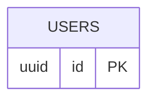
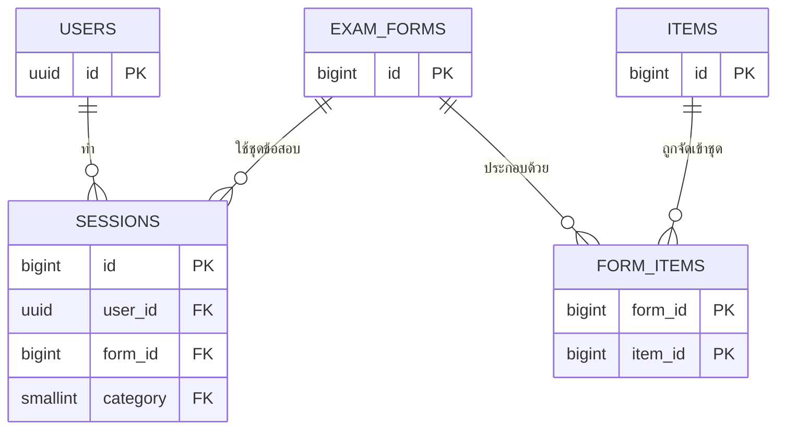
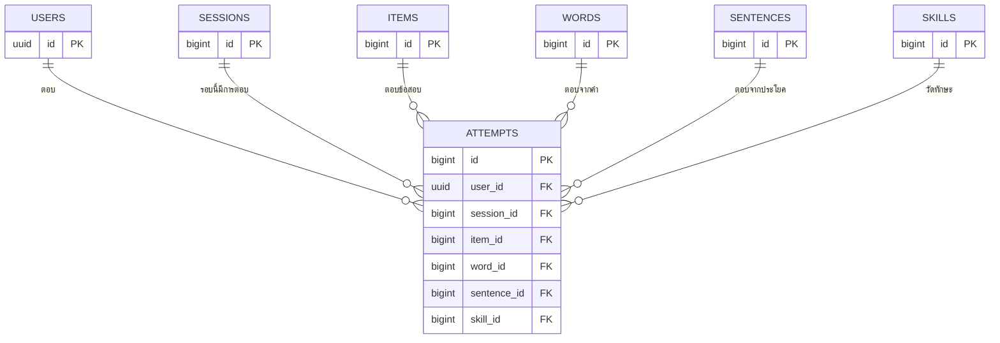
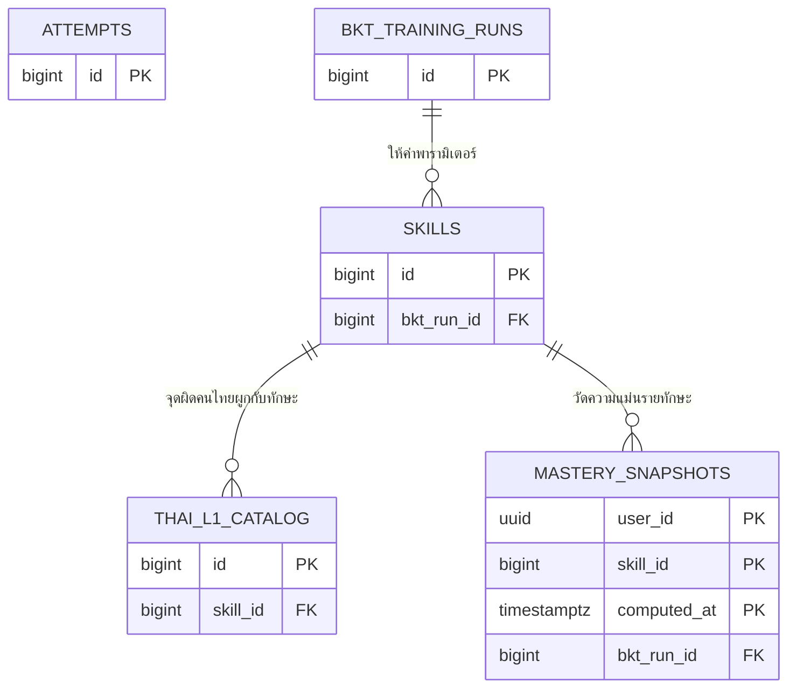
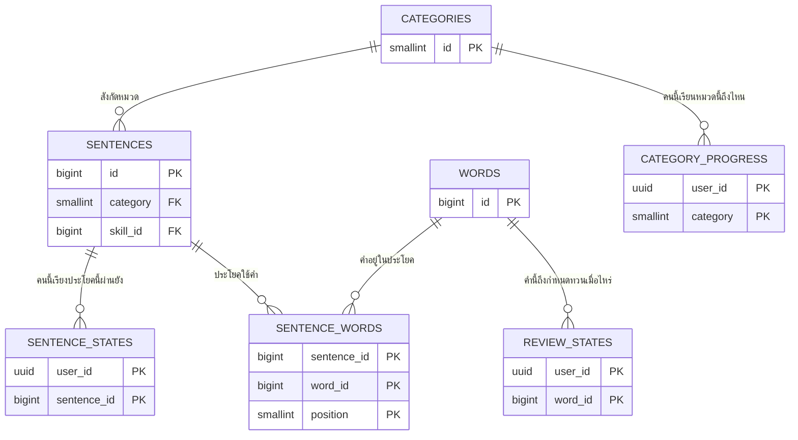
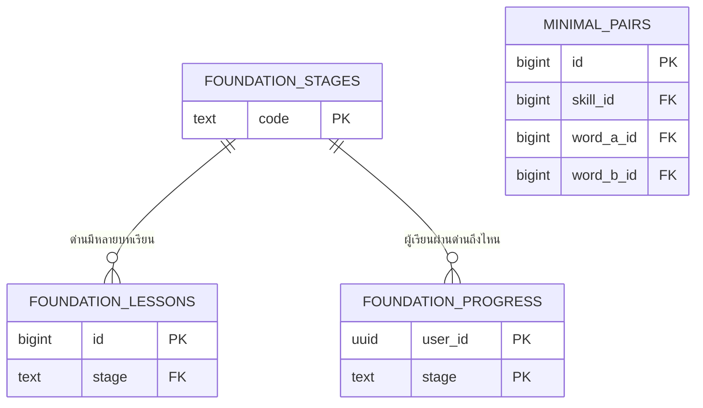

# 🗺️ ER ฉบับย่อ — หัวตาราง + คีย์ (การบ้านอาจารย์ นัดรอบ 5)

> **โจทย์จากอาจารย์ (24 ส.ค. 2026):** *"ผังเต็มเส้นก่ายกันดูยาก — ทำฉบับย่อ หัวตาราง + คีย์ (PK/FK) เท่านั้น ไว้ใช้อธิบายตอนสอบ"*
> และ *"ไม่ได้สิ ต้องไปด้วยกันทั้งคู่"* — **ทั้งทีมต้องอธิบายได้ทั้งผัง**
>
> วิธีทำความเข้าใจที่อาจารย์สอน: **ไล่ตามกระบวนการผู้ใช้** ไม่ใช่ท่องทีละตาราง → ไฟล์นี้จึงเรียงตามการเดินของผู้เรียน
>
> รายละเอียดเต็มทุกคอลัมน์อยู่ที่ [`DATABASE-ER.md`](DATABASE-ER.md) (แหล่งจริง) · ไฟล์นี้คือ **ฉบับพกไปคุย** ตัดคอลัมน์ออกหมด เหลือแต่ชื่อตารางกับคีย์
>
> 🆕 **23 ก.ย. — ผังแผ่นเดียวเรียงตามที่อาจารย์ไล่ (นัดรอบ 6):** [`ER-เดินตามผู้ใช้-星航.drawio`](ER-เดินตามผู้ใช้-星航.drawio) — 7 คอลัมน์ สมัคร → pre-test → ตอบ → เรียนหมวด → ปูพื้น → สมอง → หลังบ้าน · มี 2 ตารางใหม่ (`category_progress`, `sentence_states`) และตัด `recommendations` แล้ว · สร้างด้วย `python scripts/gen_er_diagrams.py --story`
> **ผังที่พกไปคุยอาจารย์ = [`ER-เดินตามผู้ใช้-星航.drawio`](ER-เดินตามผู้ใช้-星航.drawio)** (v2 28 ก.ย.: แผ่นเดียว 2 แถว — บน = ก้าวผู้ใช้ ①→⑤ · ล่าง = ⑥ สมอง BKT · 24 ตาราง · เส้นไม่พาดทับกล่อง) · สร้างใหม่เมื่อ schema เปลี่ยน: `python scripts/gen_er_diagrams.py --story`
> 🗑️ **18 พ.ย. 2026 — ลบ `ER-ฉบับย่อ-星航.drawio` (ผัง 7 หน้า layout มือ) แล้ว** (บอลเคาะ): ค้างอยู่ที่ 23 ตารางก่อน 23 ก.ย. และหน้าที่ซ้ำกับผังเดินตามผู้ใช้ · โหมด `--slim` ถอดออกจากสคริปต์ด้วย
>
> 🖼️ **ต้องการรูปไปใส่เล่ม/โปสเตอร์ →** รูปในเล่ม full paper = [`รูป2-ฐานข้อมูล.png`](../01_เอกสารโครงงาน/fullpaper-รูป/รูป2-ฐานข้อมูล.png) (24 ตาราง จัด 7 กลุ่ม · `.drawio` ข้าง ๆ แก้ต่อได้ · สร้างด้วย `python scripts/gen_paper_figures.py`) · อธิบายหน้าห้อง = ผังเดินตามผู้ใช้ข้างบน
> ทุกผังสร้างอัตโนมัติจาก `er-drawio.sql` ตัวเดียวกับผังเต็ม — ไม่มีทางขัดกันเอง (จัดตำแหน่งกล่องเองได้ แต่ถ้ารันสร้างใหม่ เลย์เอาต์ที่จัดเองจะถูกทับ — จัดหลังรันเสมอ)
>
> **ใช้อะไรตอนไหน:** อธิบายหน้าห้อง/ซ้อมตอบ → ผังเดินตามผู้ใช้ ไล่ ①→⑥ ทีละก้าว ควบกับหัวข้อ 6 ก้าวในไฟล์นี้ · ใส่เล่มหรือโปสเตอร์ → รูป2-ฐานข้อมูล (โชว์ 10 วินาทีให้เห็นว่า "ครบ 24 ตาราง" แล้วกลับมาไล่ทีละก้าว อย่าไล่เส้นบนรูปรวม) · *(บทเรียน 3 ก.ย.: ผังรวม 36 เส้นหน้าเดียวยังไงก็พันกัน — เล่าทีละก้าวคือคำตอบ)*

---

## 🔑 อ่านผังยังไง — 3 คำที่ต้องรู้ก่อน

| คำ | แปลเป็นภาษาคน | ตัวอย่างจากผังเรา |
|---|---|---|
| **PK** (คีย์หลัก) | เลขประจำตัวของแถวนี้ ห้ามซ้ำ ห้ามว่าง | `words.id` = เลขประจำตัวคำศัพท์ |
| **FK** (คีย์นอก) | เลขที่ **ยืมมาจากตารางอื่น** เพื่อชี้ว่า "แถวนี้เป็นของใคร / ของอะไร" | `attempts.user_id` ชี้ว่าการตอบนี้เป็นของใคร |
| **PK ผสม** | ใช้หลายคอลัมน์รวมกันเป็นเลขประจำตัว | `review_states(user_id, word_id)` = "คนนี้ + คำนี้" มีได้แถวเดียว |

**เคล็ดตอบกรรมการ:** ถ้าถูกถามว่าตารางนี้เกี่ยวกับตารางไหน ให้ดูที่ FK เสมอ — **FK ชี้ไปทางไหน = เกี่ยวกับตารางนั้น**

---

## 🚶 ส่วนที่ 1 · เดินตามกระบวนการผู้ใช้ (ส่วนที่ใช้ท่อง)

เดิน 6 ก้าวตามชีวิตจริงของ "มิ้นท์" ผู้เรียนพื้นศูนย์ · แต่ละก้าวใช้ตารางไม่กี่ตัว

### ก้าวที่ 1 · มิ้นท์สมัครใช้งาน

เกิด **1 แถว** ใน `users` · `id` ของแถวนี้จะถูกยืมไปเป็น FK แทบทุกตารางฝั่งประวัติ

> **เล่าว่า:** "ทุกอย่างที่ผู้เรียนทำ สุดท้ายผูกกลับมาที่ `users.id` แถวเดียวนี้ครับ"

### ก้าวที่ 2 · ทำแบบทดสอบก่อนเรียน

- `sessions` = **1 แถวต่อ 1 รอบการทำ** — แบบทดสอบก่อนเรียน / ควิซ / สอบจำลอง ใช้ตารางเดียวกัน แยกด้วยคอลัมน์ `kind`
- `exam_forms` = **ชุดข้อสอบ** · `form_items` = ตารางกลางที่บอกว่าชุดนี้มีข้อไหนบ้าง
- **ทำไมต้องมี `form_items`:** ข้อสอบ 1 ข้ออยู่ได้หลายชุด และชุด 1 ชุดมีหลายข้อ = **หลายต่อหลาย** ลากเส้นตรงไม่ได้ ต้องมีตารางคั่น

> **คำถามที่อาจารย์โยนมาแล้ว:** *"pre กับ post ต้องเชื่อมคลังข้อสอบชุดเดียวกัน"*
> **ตอบ:** ใช้ `sessions.form_id` ชี้ `exam_forms` ตัวเดียวกันทั้งสองรอบ ตามกฎ PL-09 ครับ *(ทีมรับตามแนวทางอาจารย์แล้ว 3 ก.ย. — ชุดเดียว = ข้อสอบเสมือน HSK1 ทุกคนทำ · เหลือถามอาจารย์แค่จำนวนข้อ 40 เต็มหรือฉบับย่อ)*

### ก้าวที่ 3 · มิ้นท์ตอบทีละข้อ ⭐ หัวใจของทั้งระบบ

`attempts` = **1 แถวต่อ 1 การตอบ** ตารางที่ใหญ่ที่สุดและสำคัญที่สุด — **ไม่มีตารางนี้ = ไม่มีบทที่ 4 = ไม่มีโครงงาน**

3 อย่างที่ต้องเล่าให้ได้เกี่ยวกับตารางนี้

1. **ทำไมมี FK ชี้ออก 3 ทาง** (`item_id` / `word_id` / `sentence_id`) — กิจกรรมส่วนใหญ่ในแอปวันนี้ทำงานบน **คำ** (บัตรคำ · เกมจับคู่ · ควิซที่ปั้นข้อสด) ไม่ได้อ้างคลังข้อสอบ ถ้าบังคับให้ต้องมี `item_id` ทุกแถว จะบันทึกอะไรไม่ได้เลยจนกว่าคลังข้อสอบจะเสร็จ
2. **ทำไมจด `skill_id` ซ้ำ ทั้งที่ `item_skills` ก็บอกได้** — ข้อที่ปั้นสดไม่มีแถวใน `item_skills` ให้เดิน และการจดไว้ ณ เวลาที่ตอบทำให้ **ข้อมูลทดลองเก่าไม่เปลี่ยนความหมายย้อนหลัง** เมื่อแก้ Q-matrix ทีหลัง
3. **ห้ามแก้ ห้ามลบ** — มันคือชุดข้อมูลที่ใช้เทรนโมเดล ถ้าลบได้ ผลการทดลองพิสูจน์ไม่ได้

### ก้าวที่ 4 · ระบบเริ่มรู้ว่ามิ้นท์อ่อนตรงไหน ⭐ จุดขายของโครงงาน

เส้นทางข้อมูลอ่านว่า: `attempts` สะสม → **pyBKT** คำนวณ → `mastery_snapshots` เก็บค่าความแม่นรายทักษะ → **dashboard** query จุดแข็ง/จุดอ่อน (เกณฑ์ตั้งต้น p ≥ 0.5 = แข็ง) → **Gemini** แต่งคำแนะนำจากตัวเลข (ไม่เก็บลง DB) + คำอธิบายจุดผิดจาก `thai_l1_catalog`

> **ทำไมไม่มีตาราง `recommendations` แล้ว (ตัด 23 ก.ย. ตามอาจารย์รอบ 6 — BK-08):** *"แต่ละคนไม่เหมือนกัน เขียนคำแนะนำให้ครบทุกคนไม่ได้"* → ข้อความแนะนำรายบุคคลให้ Gemini แต่งสดจากตัวเลขบน dashboard ไม่เก็บซ้ำ · ส่วน `mastery_snapshots` **คงไว้** เพราะเป็นผลคำนวณของโมเดล (posterior) ที่ SQL รวมจากตารางหลักไม่ได้ และต้องเก็บประวัติเพื่อกราฟพัฒนาการ — จุดที่ต้องชี้แจงอาจารย์นัดหน้า
>
> **ทำไมต้องมี `bkt_training_runs`:** ระหว่างทดลองเราเทรนหลายรอบ ถ้าเก็บแค่ค่าล่าสุดจะอ้างไม่ได้ว่าตัวเลขในเล่มมาจากรอบไหน ข้อมูลถึงวันไหน กี่คน

### ก้าวที่ 5 · เรียนคำศัพท์ + ระบบนัดทวน

- `review_states` PK ผสม `(user_id, word_id)` = **"คนนี้ + คำนี้" มีได้แถวเดียว** เก็บวันนัดทวนถัดไปตามอัลกอริทึม FSRS
- `sentence_words` PK ผสม 3 คอลัมน์ รวม `position` ด้วย — **`position` คือลำดับคำในประโยค และมันคือเฉลยของแบบฝึกเรียงประโยค**
- 🆕 `category_progress` (คน × หมวด) และ `sentence_states` (คน × ประโยค) — เพิ่ม 23 ก.ย. ตามอาจารย์รอบ 6: **"อะไรที่ต้องไล่ดูย้อนหลังได้ ต้องอยู่ในตาราง ไม่ใช่โค้ด"** · sentence_words ตอบได้แค่ "เสิร์ฟได้ยัง" ส่วน sentence_states ตอบ "เขาเรียงประโยคนี้ผ่านยัง"

> **การบ้านภาษาศาสตร์ข้อ 1 ที่อาจารย์สั่ง** (*"ตรวจการเรียงประโยคยังไง"*)
> **ตอบ:** เทียบลำดับที่ผู้เรียนวางกับ `sentence_words.position` ตรง ๆ แบบ rule-based ไม่ใช้ AI เดา ครับ

### ก้าวที่ 6 · บทปูพื้นฐานเสียง

- `foundation_stages` = 4 ด่าน (กติกาภาษาจีน → พินอิน → วรรณยุกต์ → เกมฟังแยกเสียง) · เกณฑ์ผ่าน 80% เก็บเป็น **ข้อมูล** ไม่ใช่เลขฝังในโค้ด
- `minimal_pairs` = คู่เสียงใกล้เคียงที่คนไทยแยกยาก (妈/马) · ชี้ `skill_id` เพื่อบอกว่าคู่นี้ดักจุดผิดข้อไหน

---

## 📋 ส่วนที่ 2 · ตารางทั้งหมด 24 ตัว — "หนึ่งแถว = อะไร" (ปรับ 23 ก.ย.: +2 −1)

> วิธีท่องที่ได้ผลที่สุด: **อ่านคอลัมน์ "หนึ่งแถว = อะไร" ให้ขึ้นใจ** ถ้าตอบข้อนี้ได้ จะตอบได้ทุกคำถามที่ตามมา

### 🟦 โซน 1 · คน (1 ตาราง)

| ตาราง | หนึ่งแถว = | PK | FK ชี้ไปไหน |
|---|---|---|---|
| `users` | ผู้ใช้ 1 คน | `id` | — |

### 🟩 โซน 2 · เนื้อหาที่เรียน (7 ตาราง)

| ตาราง | หนึ่งแถว = | PK | FK ชี้ไปไหน |
|---|---|---|---|
| `categories` | หมวดเนื้อหา 1 หมวด (มี 5) | `id` | — |
| `words` | คำศัพท์จีน 1 คำ | `id` | `categories` *(ประกาศในพิมพ์เขียว 3 ก.ย. — DB จริงวันนี้ยังเป็นเลขลอย จะบังคับจริงตอน m7-2)* |
| `sentences` | ประโยคตัวอย่าง 1 ประโยค | `id` | `categories`, `skills` |
| `sentence_words` | คำที่ 1 คำ ในประโยคที่ 1 ประโยค ณ ตำแหน่งที่ n | `(sentence_id, word_id, position)` | `sentences`, `words` |
| `foundation_stages` | ด่านปูพื้นเสียง 1 ด่าน (มี 4) | `code` | — |
| `foundation_lessons` | บทเรียน 1 บทในด่านปูพื้น | `id` | `foundation_stages` |
| `minimal_pairs` | คู่เสียงใกล้เคียง 1 คู่ | `id` | `skills`, `words` ×2 |

### 🟨 โซน 3 · ทักษะ — แกนวิชาการ (4 ตาราง)

| ตาราง | หนึ่งแถว = | PK | FK ชี้ไปไหน |
|---|---|---|---|
| `skills` | ทักษะย่อย 1 ตัว | `id` | `bkt_training_runs` |
| `thai_l1_catalog` | จุดผิดเฉพาะคนไทย 1 จุด (มี 15) | `id` | `skills` |
| `item_skills` | **Q-matrix** — ข้อสอบข้อนี้วัดทักษะตัวนี้ | `(item_id, skill_id)` | `items`, `skills` |
| `bkt_training_runs` | การเทรนโมเดล 1 รอบ | `id` | — |

### 🟥 โซน 4 · ข้อสอบ (3 ตาราง)

| ตาราง | หนึ่งแถว = | PK | FK ชี้ไปไหน |
|---|---|---|---|
| `items` | ข้อสอบ 1 ข้อ (นอนอยู่ในคลัง ใช้ซ้ำได้) | `id` | `categories`, `users` ×2 *(คนสร้าง / คนอนุมัติ)* |
| `exam_forms` | ชุดข้อสอบ 1 ชุด | `id` | — |
| `form_items` | ข้อนี้อยู่ในชุดนี้ | `(form_id, item_id)` | `exam_forms`, `items` |

### 🟪 โซน 5 · ประวัติของผู้เรียน (7 ตาราง)

| ตาราง | หนึ่งแถว = | PK | FK ชี้ไปไหน |
|---|---|---|---|
| `sessions` | **1 รอบการทำ** (ควิซ / แบบทดสอบก่อนเรียน / สอบจำลอง / รอบฝึก) | `id` | `users`, `exam_forms`, `categories` |
| `attempts` ⭐ | **1 การตอบ 1 ข้อ** | `id` | `users`, `sessions`, `items`, `words`, `sentences`, `skills` |
| `review_states` | คนนี้ + คำนี้ ถึงกำหนดทวนเมื่อไหร่ | `(user_id, word_id)` | `users`, `words` |
| `mastery_snapshots` | ความแม่นของคนนี้ ในทักษะนี้ ณ เวลานี้ | `(user_id, skill_id, computed_at)` | `users`, `skills`, `bkt_training_runs` |
| `foundation_progress` | คนนี้ผ่านด่านปูพื้นด่านนี้ถึงไหน | `(user_id, stage)` | `users`, `foundation_stages` |
| `category_progress` 🆕 | คนนี้ × หมวดนี้ เรียนถึงไหน (ผ่านกี่คำ กี่ประโยค ควิซดีสุด สถานะ) — อาจารย์รอบ 6: "ต้องเป็นตาราง ไม่ใช่โค้ด" | `(user_id, category)` | `users`, `categories` |
| `sentence_states` 🆕 | คนนี้ × ประโยคนี้ เรียงผ่านหรือยัง กี่รอบ — อาจารย์รอบ 6: "รู้ทุกคำ ≠ เรียงถูก" | `(user_id, sentence_id)` | `users`, `sentences` |

### ⬜ โซน 6 · งานหลังบ้าน (2 ตาราง)

| ตาราง | หนึ่งแถว = | PK | FK ชี้ไปไหน |
|---|---|---|---|
| `approval_transfers` | การโอนสิทธิ์อนุมัติ 1 ครั้ง | `id` | `users` ×2 |
| `roadmap_state` | สถานะติ๊กของฟังก์ชัน 1 ตัว | `item_id` | — |

---

## 🎯 ส่วนที่ 3 · ถ้าโดนถามข้อนี้ ให้ชี้ตารางนี้

| คำถาม | ชี้ตารางไหน | ตอบว่า |
|---|---|---|
| ข้อสอบเชื่อมกับคำ / ประโยคยังไง | `attempts` | ผ่าน `attempts` ที่ชี้ได้ทั้ง `item_id` · `word_id` · `sentence_id` เพราะบางกิจกรรมปั้นข้อสดจากคำ ไม่ได้อ้างคลังข้อสอบ |
| pre กับ post ใช้ชุดเดียวกันได้ยังไง | `sessions.form_id` → `exam_forms` | ทั้งสองรอบชี้ `exam_forms` ตัวเดียวกัน · แยกรอบด้วย `sessions.kind` = pretest / **posttest** (เพิ่ม 28 ก.ย. — "สอบ post แล้วหรือยัง" ตอบได้ช่องเดียว) · กันข้อรั่วด้วยธง `research_use_only` |
| ตาราง "เรียน" กับ "สอบ" ต่างกันยังไง | `sessions.kind` | ทุกกิจกรรมที่ทำเป็นรอบลง `sessions` ตารางเดียว แยกชนิดด้วย `kind` — เพิ่มชนิดใหม่ = เพิ่มแถว ไม่ต้องแก้โครงตาราง |
| ตารางกลางระหว่างผู้ใช้กับหมวดอยู่ไหน | `category_progress` | คน × หมวด 1 แถว — เริ่มเมื่อไหร่ / ผ่านกี่คำ / กี่ประโยค / ควิซดีสุด / สถานะ (เพิ่ม 23 ก.ย. ตามอาจารย์รอบ 6 "ต้องเป็นตาราง ไม่ใช่โค้ด") · `sessions` เก็บ "รอบ" รายครั้ง ไม่ใช่สถานะสรุป |
| นาย A เรียนประโยคที่ 1 ผ่านหรือยัง | `sentence_states` | แถว (user_id, sentence_id) เก็บ `tries` / `best_correct` / `passed_at` — ว่าง = ยังไม่ผ่าน · รู้ทุกคำ ≠ เรียงถูก · ข้อมูลดิบรายครั้งอยู่ `attempts.sentence_id` |
| ทำไมไม่มีตารางกลาง หมวด↔คำ / หมวด↔ประโยค ตามที่อาจารย์ร่าง | `words.category` · `sentences.category` | 1 คำสังกัด 1 หมวด (1:N) จึงเป็นคอลัมน์ FK พอ — ตารางกลางจำเป็นเฉพาะคู่ที่หลายต่อหลาย (`sentence_words`, `item_skills`, `form_items`) · ส่วน คน↔หมวด เป็น M:N จริง → `category_progress` |
| `skills` คือ ฟัง/พูด/อ่าน/เขียน ใช่ไหม | `skills.type` | **ไม่ใช่** — `skills` คือ "หน่วยความรู้" (KC) ที่ BKT ติดตาม ~23 ตัว: จุดผิดคนไทย 15 + คำศัพท์รายหมวด 5 + ทักษะ 3 (ฟัง/อ่าน/เรียงประโยค) · ฟัง/อ่านของข้อสอบดูที่ `items.module` และ `sessions.score_listening/score_reading` |
| ระบบรู้ได้ยังไงว่าผู้เรียนอ่อนอะไร | `attempts` → `mastery_snapshots` | สะสม `attempts` เฉพาะ `event_type='graded'` → pyBKT → เก็บผลที่ `mastery_snapshots` |
| ทำไมต้องมีตารางกลาง 3 ตัว | `item_skills` · `form_items` · `sentence_words` | ทั้งสามคือความสัมพันธ์ **หลายต่อหลาย** ลากเส้นตรงไม่ได้ ต้องมีตารางคั่น |
| ตรวจคำตอบใช้ AI ไหม | `sentence_words.position` · `items.answer_key` | ไม่ใช้ · เทียบเฉลยตายตัวด้วย rule ของเราเอง |

---

## ⚠️ จุดที่ยังไม่นิ่ง — ถ้าโดนถามให้ตอบตามจริง

| เรื่อง | สถานะจริง |
|---|---|
| ตารางที่สร้างจริงแล้ว | **ครบ 24 ตาราง + view `items_public`** รันจริงบน Supabase 8 ต.ค. 2026 (migration 0005/0006) — แต่แอปยังเขียนลงตารางฝั่งผู้เรียนไม่ได้จนกว่าจะมีล็อกอิน (ตอนนี้ยังอยู่ localStorage) |
| `words.category` | ✅ ผูก FK จริงแล้ว 8 ต.ค. 2026 (`words_category_fk` ใน migration 0005) — เส้น words → categories ในผังตรงกับ DB |
| FS-04 | ✅ เคาะแล้ว (ก.ย.): เพดานทวน **40 คำ/วัน** (`REVIEW_CAP_PER_DAY` ใน `apps/web/src/lib/fsrs.ts`) |
| ไฟล์ `ER-ฉบับย่อ-星航.drawio` | 🗑️ **ลบแล้ว 18 พ.ย. 2026** (บอลเคาะ) — ค้าง 23 ตาราง + หน้าที่ซ้ำ · ผังย่อที่ใช้ = `ER-เดินตามผู้ใช้-星航.drawio` (24 ตาราง แผ่นเดียว) |

## 🔗 เกี่ยวข้อง

[`DATABASE-ER.md`](DATABASE-ER.md) (แหล่งจริง ฉบับเต็ม) · [`ความต้องการข้อมูล-User-Journey.md`](ความต้องการข้อมูล-User-Journey.md) (สคริปต์เดินตามผู้ใช้ ฉบับยาว) · [`er-drawio.sql`](er-drawio.sql) (DDL)
