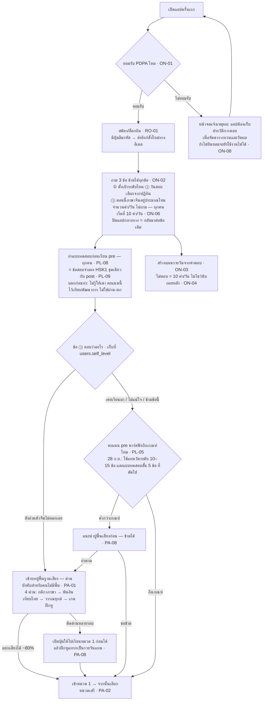
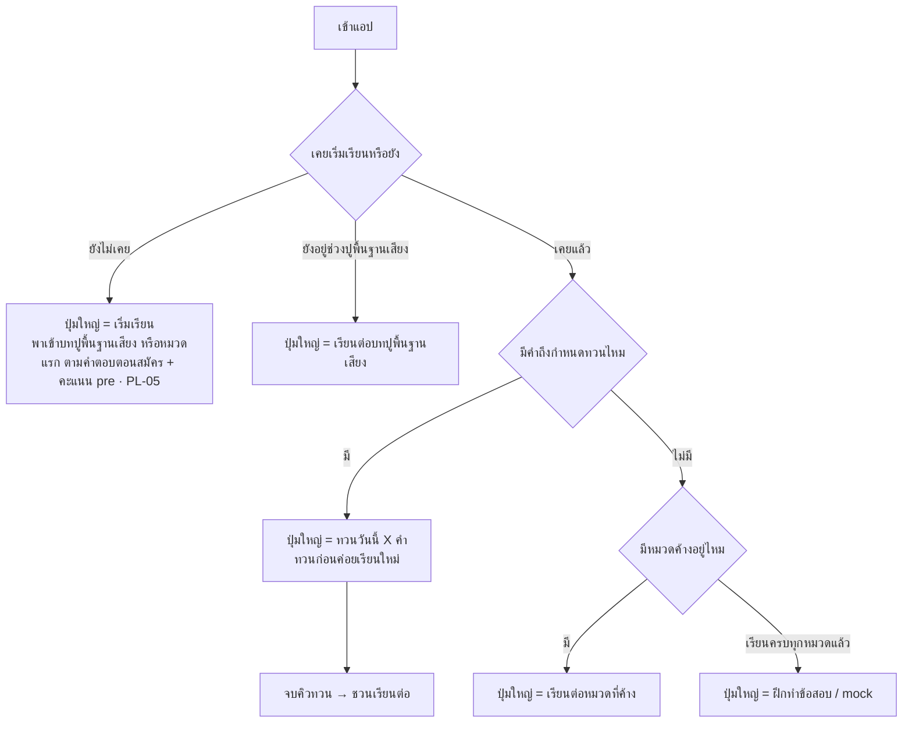
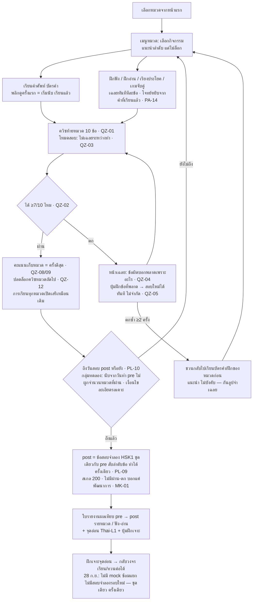
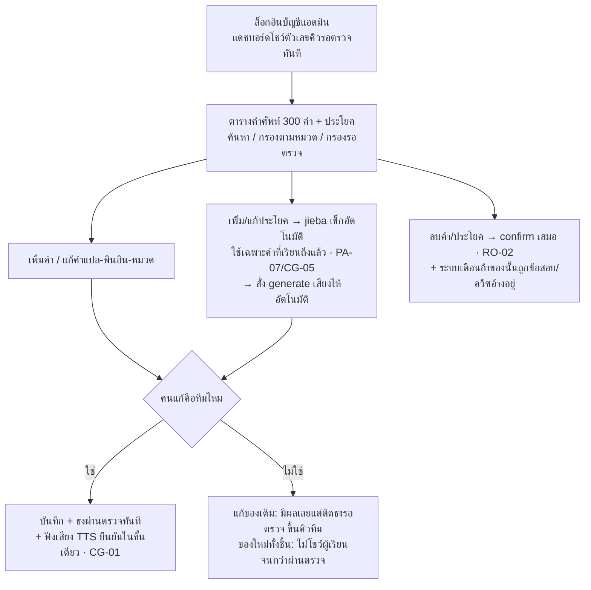
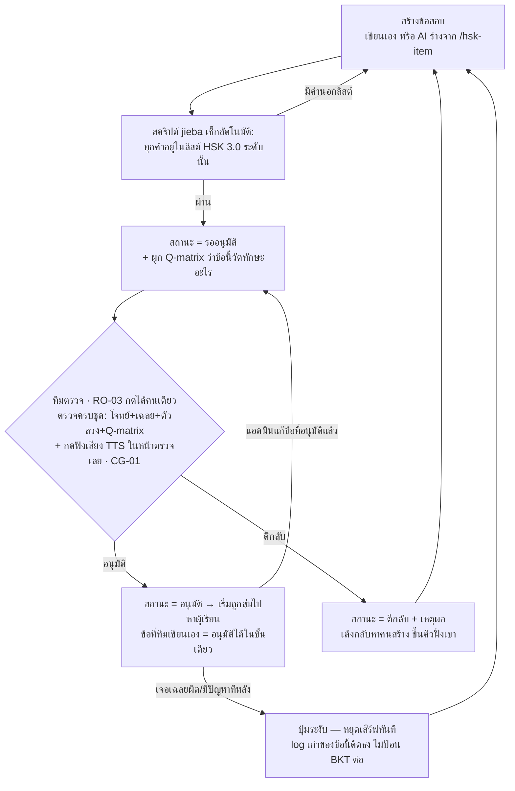
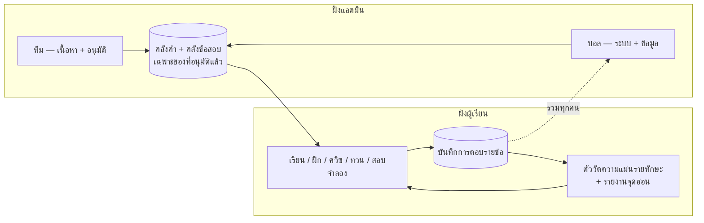

# 🧭 โฟลว์การใช้งาน + สิทธิ์ของแต่ละบทบาท (ผู้เรียน / แอดมิน)

> อัปเดต: 5 ส.ค. 2026 · ยึดกฎจาก `กฎการทำงานระบบ-BUSINESS-RULES.md` (อ้างรหัสกำกับทุกจุด)
> แผนภาพเป็น mermaid — เปิดใน Obsidian หรือ GitHub จะเห็นเป็นผังอัตโนมัติ
> 🧭 **คู่กับไฟล์นี้:** [`ความต้องการข้อมูล-User-Journey.md`](ความต้องการข้อมูล-User-Journey.md) — คนละมุมกัน ไฟล์นี้ตอบ *"กดแล้วไปไหน + ใครมีสิทธิ์อะไร"* · ไฟล์นั้นตอบ *"ผู้เรียนรู้สึกยังไงตลอดเส้นทาง + แต่ละก้าวระบบต้องจำอะไร"*

---

## 1) บทบาทในระบบ — มี 3 แบบ

| บทบาท | ใคร | สรุปหน้าที่ |
|---|---|---|
| **ผู้เรียน (Member)** | คนไทยเตรียมสอบ HSK 1 | เรียน ฝึก สอบ ดูผลของตัวเอง — แก้อะไรของระบบไม่ได้เลย |
| **แอดมิน** | ทีม (RO-02) | จัดการคำศัพท์ / ประโยค / ข้อสอบ / ติ๊ก roadmap · การลบต้อง confirm เสมอ |
| **ผู้อนุมัติเนื้อหา** | **คนเดียว** (RO-03) | ปุ่ม "อนุมัติข้อสอบ" กดได้เฉพาะบัญชีเธอ — บอลเป็นแอดมินก็กดแทนไม่ได้ |

> ⚠️ สถานะตอนนี้ (ก่อน m7-1): **ยังไม่มีล็อกอิน** — ทุกคนเป็น "ผู้เรียนนิรนาม" ข้อมูลอยู่ในเครื่องตัวเอง (localStorage) · แอดมินแก้ของผ่านสคริปต์/SQL เอา · มีช่องเปิด 2 จุดที่ต้องล็อกทันทีที่ Auth มา: ตาราง `roadmap_state` เขียนได้ทุกคน + endpoint แก้คำแปลไม่มี auth (RO-04)

---

## 2) ตารางสิทธิ์ — ใครทำอะไรได้ (หลังโมดูล 7 เสร็จ)

| การกระทำ | ผู้เรียน | แอดมิน (บอล) | ทีม |
|---|:---:|:---:|:---:|
| เรียนบัตรคำ / ฝึก / ควิซ / ทวน / mock | ✅ | ✅ | ✅ |
| ดูผลการเรียน**ของตัวเอง** + ตั้งค่าปริมาณเรียน (ON-06) | ✅ | ✅ | ✅ |
| สมัคร/ล็อกอิน + ยินยอม PDPA ก่อนระบบเก็บ log (ON-01, RO-01) | ✅ | ✅ | ✅ |
| เพิ่ม/แก้/ลบ **คำศัพท์ + หมวด + ประโยค** | ❌ | ✅ | ✅ |
| เพิ่ม/แก้ **ข้อสอบเข้า item bank** (สถานะเริ่ม = รออนุมัติ) | ❌ | ✅ | ✅ |
| **อนุมัติ/ตีกลับข้อสอบ** ก่อนถึงผู้เรียน | ❌ | ❌ | ✅ |
| ยืนยันคำแปล/พินอินที่ถูกแก้ (ธง `th_reviewed`) | ❌ | ❌ | ✅ |
| ติ๊ก roadmap (team-shared) | ❌ | ✅ | ✅ |
| ดู log การตอบรวมทุกคน (วัตถุดิบ BKT) | ❌ | ✅ | ✅ |
| ลบเนื้อหาระบบ (มี confirm เสมอ — RO-02) | ❌ | ✅ | ✅ |
| **ลบบัญชี + ข้อมูลของตัวเอง / ถอนความยินยอม** (สิทธิตาม PDPA — ต้องเขียนวิธีไว้ใน consent ตาม ON-05) | ✅ | ✅ | ✅ |

หลักจำง่าย ๆ: **ผู้เรียนแตะได้แค่ของตัวเอง · แอดมินแตะเนื้อหาได้ · แต่ของที่จะไปโผล่หน้าผู้เรียนเป็น "ข้อสอบ/คำแปล" ต้องผ่านมือทีมเสมอ**

---

## 3) โฟลว์ผู้เรียน

### 3.1 เข้าใช้ครั้งแรก (Onboarding — ON-01..07)

> 🆕 **มติอาจารย์นัดรอบ 3 (12 ส.ค.) + บอลรับ 14 ส.ค.:** เข้าครั้งแรก**ทุกคนต้องทำ "แบบทดสอบก่อนเรียน"** ครอบ 5 หมวด เป็นคะแนนฐานเทียบกับตอนเรียน (PL-08) — ผลต่ำมาก → เริ่มปูพื้นฐานเสียง · ผลดี → เลือกเรียนเลย · **โครงชุดข้อสอบยังไม่ออกแบบ** ("ค่อยว่ากัน") เมื่อออกแบบเสร็จ ทางแยกข้อ ③ ในผังล่างนี้จะถูกปรับให้ใช้ผลแบบทดสอบแทนการให้ผู้เรียนประเมินตัวเอง · **3 ก.ย. บอลเคาะตามอาจารย์รอบ 4:** ชุดนี้ = **ข้อสอบเสมือน HSK1 ชุดเดียวกับ post** ทุกคนทำ ไม่มีข้าม (จำนวนข้อ 40/ย่อ รอถาม)

- **ชุดคำถามนี้ทบทวนใหม่ 6 ส.ค.** (ของเดิมเป็นโครงคร่าว ๆ จากอาจารย์) — หลักที่ใช้: ทุกข้อผู้เรียนต้องตอบได้ทันทีโดยไม่ต้องเดา และทุกข้อต้องมีผลกับระบบที่ชี้ได้ · รายละเอียดข้อต่อข้อดู ON-02
- **ตัดคำถาม "กี่นาทีต่อวัน" ออก** — ไม่มีสูตรแปลงเป็นแผน และซ้ำกับข้อ ④ ที่ระบบใช้จริง
- ข้อ ② ถามเป็น **"เลือกวันที่สอบจากปฏิทิน"** ไม่ใช่ "เหลือกี่วัน" — ระบบนับวันให้เอง
- ข้อ ③ ห้ามใช้คำว่า "มีพื้นฐานไหม" — ถามด้วยสิ่งที่ทำได้จริง (อ่านตัวจีนออกไหม / ทักทาย-นับเลขได้ไหม) เพราะคนเพิ่งเริ่มตัดสินตัวเองไม่ได้
- ทุกข้อ**โชว์ผลลัพธ์สดตอนเลือก** เช่น กด "10 คำ/วัน" ขึ้นทันทีว่า "ครบ 300 คำใน ~30 วัน" → เลือกอย่างมีข้อมูล ไม่ใช่เดา
- ตอบ "จะสอบ HSK2" → **เส้นทางเดิม เปลี่ยนแค่เป้า** (แถบคืบหน้านับเทียบ 500 คำ + บอกตรง ๆ ว่าเนื้อหาช่วงนี้คือ HSK1) — ON-07
- ปริมาณเรียนต่อวัน **fix 10 คำ/วันทุกคน** (มติ 14 ส.ค. ตามคำแนะนำอาจารย์ — ON-06) · ไม่ถามตอนสมัคร ไม่มีช่องปรับ (เปิดทีหลังถ้าจำเป็น)
- ตอบว่าอ่านตัวจีนออกแล้วเรียนจริงไม่ไหว → **กลับเข้าบทปูพื้นฐานเสียงได้เสมอ**จากการ์ดบนหน้าแรก (ในแผนงานทีมเรียกส่วนนี้ว่าโมดูล 0)
- ผู้ใช้ยุคก่อนมีล็อกอิน (ข้อมูลใน localStorage): ตอนสมัครครั้งแรก ระบบ**ดูดความคืบหน้าในเครื่องขึ้นบัญชี**ให้อัตโนมัติ — กติกากรณีมีข้อมูลทั้งสองที่ ดูข้อ 7

### 3.2 กลับมาเรียนรายวัน (MO-01)

> โค้ดหน้าแรกปัจจุบันมีกิ่ง "ยังไม่เคย" แล้ว (ปุ่ม "เริ่มเรียน · หมวดแรก") — กิ่ง "ยังอยู่ช่วงปูพื้นฐานเสียง" จะมีจริงเมื่อบทปูพื้นฐานเสียงสร้างเสร็จ

### 3.3 วงจรเรียนในหมวด (PA-10 + QZ)

- ระหว่างทาง ระบบ**ทวนแบบเว้นช่วง**ทำงานเบื้องหลังตลอด: คำที่เรียนแล้วจะโผล่ในคิวทวนตามจังหวะลืม (โมดูล 4)
- ทุกการตอบ (ฝึก+ควิซ+mock) ถูก log รายข้อ → เป็นวัตถุดิบวัดความแม่นรายทักษะ (โมดูล 8)

---

## 4) โฟลว์แอดมิน (โมดูล 7 — ยังไม่ได้สร้าง ให้สร้างตามนี้)

### 4.1 จัดการคำศัพท์/ประโยค (m7-2)

### 4.2 จัดการข้อสอบ + ขั้นอนุมัติ (m7-3 — หัวใจของ item bank)

วงจรชีวิตข้อสอบมี 5 สถานะ: **ร่าง → รออนุมัติ → อนุมัติ → (ตีกลับ) → ระงับ**

**กฎเหล็กของท่อนี้:**
- ข้อสอบที่ไม่ได้อยู่สถานะ "อนุมัติ" **ไม่มีทางโผล่หาผู้เรียน** ไม่ว่ากรณีใด (กติกาทีม + CG) · ตรวจคำตอบด้วยเฉลยตายตัว 100% ห้ามใช้ AI ตรวจ (QZ-07)
- **แก้ข้อที่อนุมัติแล้ว = สถานะเด้งกลับ "รออนุมัติ" อัตโนมัติ** (กันทางลัดข้ามด่านทีม) — ยกเว้นทีมแก้เอง
- ระงับ/ตีกลับจนข้อในหมวด**เหลือน้อยกว่าขั้นต่ำที่สุ่มควิซได้** → ระบบเตือนแอดมินทันที (ตัวเลขขั้นต่ำ ดูข้อ 7)

### 4.3 งานแอดมินอื่น

- **ติ๊ก roadmap** — หลัง Auth มา จำกัดสิทธิ์เขียน `roadmap_state` เฉพาะแอดมิน (ปิดช่อง RO-04)
- **ดู log การตอบรวม** — ไว้เทรน pyBKT + ทำ dashboard จุดอ่อนผู้เรียน (โมดูล 8)
- **จัดการบัญชีตัวเอง** — เปลี่ยนรหัสผ่าน ฯลฯ ตาม Supabase Auth มาตรฐาน

---

## 5) ทางเดินข้อมูลสรุปภาพเดียว

## 6) สิ่งที่ต้องทำเพื่อให้โฟลว์นี้เป็นจริง (ผูกกับ roadmap)

| ลำดับ | งาน | roadmap |
|---|---|---|
| 1 | สมัคร/ล็อกอิน + **หน้าลืมรหัสผ่าน** + ฟอร์ม PDPA (ON-01/05 — ข้อความ consent ยังไม่เขียน ต้องปรึกษาอาจารย์ · ต้องมีวิธีถอนความยินยอม/ลบบัญชี) | m7-1 |
| 2 | Admin จัดการคำศัพท์+ประโยค (ธง th_reviewed ตาม 4.1 + jieba + gen เสียงอัตโนมัติ) | m7-2 |
| 3 | Admin item bank 5 สถานะ + ปุ่มอนุมัติเฉพาะทีม + ปุ่มระงับ + คิวรอตรวจบนแดชบอร์ด | m7-3 |
| 4 | ปิดช่องเปิด 2 จุด (roadmap_state + endpoint แก้คำแปล) | ทำพร้อม m7-1 |
| 5 | Onboarding 3 คำถาม (ON-02 ฉบับ 14 ส.ค.) + เก็บคำตอบ ③ ลง `users.self_level` + แผนรายวัน + แก้คำตอบย้อนหลังในโปรไฟล์ · **28 ก.ย.: ไม่มี micro-check / วัดระดับแล้ว** — ทุกคนทำ pre แล้วใช้คะแนนพาไปโมดูล 0 หรือหมวด 1 (PL-05) | m5-5 |
| 6 | ย้าย progress/log จาก localStorage ขึ้น Supabase ผูกบัญชี (+ ดูดข้อมูลนิรนามตอนสมัคร) | m4-3, m3-2 |

---

## 7) ยังไม่เคาะ — ทีมต้องตัดสิน (จากการสวมบทเดินโฟลว์ 3 บทบาท · 5 ส.ค.)

> ✅ เคาะแล้ว 6 ส.ค. (รอบ 2): **ชุดคำถาม onboarding ใหม่ 4 ข้อ** *(ต่อมา 14 ส.ค. ตัดข้อ "วันละกี่คำ" ออก → ปัจจุบันเหลือ 3 ข้อ ตาม ON-02/ON-06)* — ตัด "กี่นาทีต่อวัน" ทิ้ง · วันสอบเลือกจากปฏิทิน · ข้อระดับถามด้วยสิ่งที่ทำได้จริง + มีช่อง "ไม่แน่ใจ" ที่ให้ผู้เรียนเลือกเองว่าจะวัดหรือเริ่มจากศูนย์ (ON-02/ON-09)
>
> ✅ เคาะแล้ว 6 ส.ค.: **ไม่ยอมรับ PDPA = เข้าใช้ไม่ได้** (วนกลับหน้าเริ่มต้น ผ่านจอคั่นอธิบายเหตุผล — ON-08 บอลเคาะ) · ผลพลอยได้: คำถาม merge ข้อมูล guest หายไปเกือบหมด เหลือเฉพาะช่วงเปลี่ยนผ่านผู้ใช้ยุคก่อนมีล็อกอิน

| # | คำถาม | ข้อเสนอตั้งต้น | ใครเคาะ |
|---|---|---|---|
| 1 | ประตูนุ่ม PA-08: "ติดด่านหลายรอบ" = กี่รอบ, ออกไปแล้วต้องกลับมาปิด 80% ไหม | ✅ **เคาะตามข้อเสนอ (บอลยืนยัน 3 ก.ย.)**: ไม่ผ่านครบ 3 รอบ → เปิดปุ่ม · ไม่บังคับกลับมาปิด แต่แบบฝึกหูแทรกในคิวทวนรายวันจนกว่าจะถึง 80% — ลงเป็นข้อมูลแล้วใน `foundation_stages` (pass_threshold 0.80 · soft_gate_after_tries 3) | ✅ บอล 3 ก.ย. |
| 2 | ควิซโดนขัดจังหวะ (สายเข้า/สลับแอป) | ค้าง <10 นาทีกลับมาต่อได้ เกินนั้นทิ้งรอบ (ไม่นับเป็นตก) แต่ข้อที่ตอบแล้ว log ตามจริง | บอล |
| 3 | mock ทำซ้ำได้แค่ไหน + กันจำข้อชุด post | ✅ **เคาะตามข้อเสนอ (บอลยืนยัน 3 ก.ย.)**: โหมด practice ใช้เฉพาะชุดที่ไม่ใช่ post · ชุด post ล็อกจนถึงวันวัดผล — schema รองรับแล้ว: `exam_forms.research_use_only` + `locked_until` (21 ส.ค.) | ✅ ทีม |
| 4 | ขั้นต่ำข้อสอบต่อหมวดก่อนควิซเปิดสุ่มได้ | 15 ข้อ/หมวด (สุ่ม 10 ไม่ซ้ำหน้ากันเกินไป) — ตัวเลขจริงรอเคาะกับขนาด item bank | ทีม |
| 5 | ผู้ใช้ยุคก่อนมีล็อกอิน (ข้อมูลใน localStorage) สมัครบัญชีครั้งแรกแล้ว merge ยังไง | เอาตัวที่ใหม่กว่าเป็นรายคำ (ไม่ใช่ทับทั้งก้อน) | บอล |
| 6 | บัญชีผู้อนุมัติใช้ไม่ได้ (ลืมรหัส/หลุด) ใครอนุมัติแทน | โอนสิทธิ์ชั่วคราวต้องแก้ที่ DB โดยบอล + จดบันทึกการโอนทุกครั้ง | ทีม |
| 7 | ~~เกณฑ์ตัดของแบบทดสอบสั้น 5 ข้อ~~ ตกไป 28 ก.ย. (ตัดแบบทดสอบสั้น) → เหลือเกณฑ์ตัดคะแนน pre พาร์ตฟัง (PL-05) | ข้อเสนอ: ฟัง ≥ 60% → ข้ามโมดูล 0 ได้ · ต่ำกว่า → แนะนำโมดูล 0 (ข้ามได้) — เคาะพร้อมจำนวนข้อ pre | บอล + ฝั่งเนื้อหา |
| 8 | **ใหม่ 14 ก.ย. (อาจารย์รอบ 6)** — ตารางกลาง **คน ↔ หมวด**: "ใครเรียน content ไหน ผ่านกี่คำ กี่ประโยค คะแนนเท่าไหร่ — ต้องเป็นตาราง ไม่ใช่โค้ด ไม่งั้นไล่ไม่ได้" | ✅ **เคาะ 23 ก.ย. — เพิ่มแล้วใน er-drawio.sql** `category_progress` (user_id, category, started_at, words_learned [cache], sentences_passed [cache], quiz_best_score [cache], quiz_passed_at, status) · content↔word / content↔sentence มีแล้วในรูป words.category / sentences.category ไม่ต้องสร้างซ้ำ | ✅ บอล 23 ก.ย. |
| 9 | **ใหม่ 14 ก.ย. (อาจารย์รอบ 6)** — ตาราง **คน ↔ ประโยค**: "นาย A เรียนประโยคที่ 1 ผ่านไหม — รู้ทุกคำ ≠ เรียงประโยคถูก" | ✅ **เคาะ 23 ก.ย. — เพิ่มแล้วใน er-drawio.sql** `sentence_states` (user_id, sentence_id, tries, best_correct, last_at, passed_at) คู่แฝด review_states · ข้อมูลดิบมีใน attempts.sentence_id อยู่แล้ว | ✅ บอล 23 ก.ย. |
